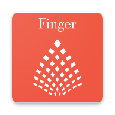

# FingerMobile Protocol Platform - Style Guide & Component Library

## 📚 Overview
This document provides a comprehensive guide to all components, styles, and patterns used across the FingerMobile platform.

---

## 🎨 Design Tokens

### Colors

#### Primary Palette
```css
--fm-primary: #0021f3;        /* FingerMobile Blue */
--fm-primary-dark: #0018b3;   /* Dark Blue */
--fm-primary-light: #3347f5;  /* Light Blue */
--fm-secondary: #6366f1;      /* Indigo */
--fm-accent: #f59e0b;         /* Amber */
```

#### Status Colors
```css
--fm-success: #10b981;        /* Green */
--fm-danger: #ef4444;         /* Red */
--fm-warning: #f59e0b;        /* Amber */
--fm-info: #3b82f6;           /* Blue */
```

#### Neutral Palette
```css
--fm-gray-50: #f9fafb;
--fm-gray-100: #f3f4f6;
--fm-gray-200: #e5e7eb;
--fm-gray-300: #d1d5db;
--fm-gray-400: #9ca3af;
--fm-gray-500: #6b7280;
--fm-gray-600: #4b5563;
--fm-gray-700: #374151;
--fm-gray-800: #1f2937;
--fm-gray-900: #111827;
```

### Dark Mode Colors
```css
--fm-dark-bg: #0f172a;
--fm-dark-bg-secondary: #1e293b;
--fm-dark-bg-tertiary: #334155;
--fm-dark-text: #f1f5f9;
--fm-dark-text-secondary: #94a3b8;
--fm-dark-border: #334155;
--fm-dark-card: #1e293b;
```

### Typography

#### Font Family
```css
font-family: -apple-system, BlinkMacSystemFont, 'Segoe UI', Roboto, 
             'Helvetica Neue', Arial, sans-serif;
```

#### Font Sizes
```css
text-xs: 12px
text-sm: 14px
text-base: 16px
text-lg: 18px
text-xl: 20px
text-2xl: 24px
text-3xl: 30px
text-4xl: 36px
text-5xl: 48px
```

### Spacing
```css
1: 4px
2: 8px
3: 12px
4: 16px
5: 20px
6: 24px
8: 32px
10: 40px
12: 48px
16: 64px
```

---

## 🧩 Components

### 1. Header

**File**: `header-component.html`

**Structure**:
```html
<header class="fm-header text-white shadow-lg sticky top-0 z-30">
  <div class="max-w-7xl mx-auto px-4 sm:px-6 lg:px-8">
    <div class="flex justify-between h-16">
      <!-- Left: Burger + Logo + Nav -->
      <div class="flex items-center flex-1">
        <button id="burger-menu-button">...</button>
        <div class="flex-shrink-0 flex items-center">
          
          <h1>Page Title</h1>
        </div>
        <nav class="hidden md:ml-6 md:flex md:space-x-8">...</nav>
      </div>
      <!-- Right: Actions + Profile -->
      <div class="flex items-center space-x-2">
        <button>Notifications</button>
        <button>Profile</button>
      </div>
    </div>
  </div>
</header>
```

**Variants**:
- Default: Blue gradient (`#0021f3` → `#6366f1`)
- Page-specific: Customize gradient per page

### 2. Footer

**File**: `footer-component.html`

**Structure**:
```html
<footer class="bg-white border-t border-gray-200 mt-auto">
  <div class="max-w-7xl mx-auto py-4 md:py-6 px-4 sm:px-6 lg:px-8">
    <div class="flex flex-col md:flex-row md:justify-between md:items-center">
      <div class="flex items-center">
        
        <p>&copy; 2026 FingerMobile Protocol</p>
      </div>
      <div class="flex gap-4 md:gap-6">
        <a href="#">Privacy</a>
        <a href="#">Terms</a>
        <a href="#">Support</a>
        <a href="#">Contact</a>
      </div>
    </div>
  </div>
</footer>
```

### 3. Burger Menu

**File**: `burger-menu-component.html`

**Structure**:
```html
<!-- Overlay -->
<div id="burger-menu-overlay" class="burger-menu-overlay"></div>

<!-- Menu -->
<div id="burger-menu" class="burger-menu">
  <!-- Header with profile -->
  <div class="burger-menu-header">
    <button id="burger-menu-close">X</button>
    <div class="burger-menu-profile">
      
      <div>
        <div class="font-semibold">Name</div>
        <div class="text-sm">💰 12.45 FIC</div>
      </div>
    </div>
  </div>
  
  <!-- Sections -->
  <div class="burger-menu-section">
    <div class="burger-menu-section-title">Community</div>
    <a href="#" class="burger-menu-item">
      <svg>...</svg>
      <span>Forum</span>
      <span class="burger-menu-item-badge">24</span>
    </a>
  </div>
</div>
```

**Sections**:
1. Community (Forum, Community, Groups, Messages)
2. Content (Gems, Blogs, Trends, Gallery)
3. Media (Beatwave NG, Dancia-4TV, Finger Wars, Finger Lux)
4. Finance (Wallet, Financials, Portfolio, FIC Vault)
5. Commerce (Marketplace, Storefronts)
6. Tools (Subscriptions, Referrals, Hallmarks, Gifting)
7. Learning (CAMUS LMS, MI)
8. Admin (Admin, Canary, Flamingo, SEADS)

### 4. Cards

#### Post Card
```html
<div class="post-card p-4">
  <div class="flex items-start">
    
    <div class="ml-3 flex-1">
      <div class="flex items-center justify-between">
        <div>
          <span class="font-semibold">Name</span>
          <span class="text-sm text-gray-500">@user · 2h ago</span>
        </div>
      </div>
      <p class="mt-2 text-gray-700">Content...</p>
      <div class="mt-3 flex items-center justify-between pt-3 border-t">
        <button>❤️ Like</button>
        <button>💬 Comment</button>
        <button>🔗 Share</button>
      </div>
    </div>
  </div>
</div>
```

#### Stat Card
```html
<div class="stat-card p-4 text-center">
  <div class="text-2xl md:text-3xl font-bold text-indigo-600">12.4K</div>
  <div class="text-sm text-gray-500 mt-1">Members</div>
</div>
```

#### Product Card
```html
<div class="track-card bg-gray-700 rounded-lg overflow-hidden">
  <div class="h-32 md:h-40 bg-gradient-to-br from-purple-600 to-pink-600">
    <!-- Image -->
  </div>
  <div class="p-3 md:p-4">
    <h3 class="text-sm md:text-base font-semibold">Title</h3>
    <p class="text-xs md:text-sm text-gray-400">Subtitle</p>
    <div class="mt-2 flex items-center justify-between text-xs">
      <span>👁 125K</span>
      <span>❤️ 8.5K</span>
    </div>
  </div>
</div>
```

### 5. Buttons

#### Primary Button
```html
<button class="px-6 py-3 bg-white text-indigo-700 font-semibold rounded-lg hover:bg-gray-100 transition">
  Action
</button>
```

#### Secondary Button
```html
<button class="px-6 py-3 border-2 border-white text-white font-semibold rounded-lg hover:bg-white hover:bg-opacity-10 transition">
  Action
</button>
```

#### Icon Button (Mobile)
```html
<button class="p-2 rounded-md text-white hover:bg-white hover:bg-opacity-20">
  <svg class="h-5 w-5">...</svg>
</button>
```

### 6. Badges

#### Status Badge
```html
<span class="inline-flex items-center px-2.5 py-0.5 rounded-full text-xs font-medium bg-purple-100 text-purple-800">
  Category
</span>
```

#### Notification Badge
```html
<span class="burger-menu-item-badge">24</span>
```

### 7. Inputs

#### Text Input
```html
<input type="text" 
       placeholder="Search..." 
       class="w-full px-3 py-2 border border-gray-300 rounded-md shadow-sm focus:outline-none focus:ring-indigo-500 focus:border-indigo-500">
```

#### Select
```html
<select class="w-full px-3 py-2 border border-gray-300 rounded-md shadow-sm focus:outline-none focus:ring-indigo-500 focus:border-indigo-500">
  <option>Option 1</option>
</select>
```

### 8. Loading States

**File**: `loading-states.css`

#### Skeleton Card
```html
<div class="skeleton-card">
  <div class="skeleton skeleton-title"></div>
  <div class="skeleton skeleton-text"></div>
  <div class="skeleton skeleton-text"></div>
</div>
```

#### Spinner
```html
<div class="loading-spinner"></div>
<div class="loading-spinner-sm"></div>
<div class="loading-spinner-lg"></div>
```

#### Loading Overlay
```html
<div class="loading-overlay">
  <div class="loading-spinner"></div>
</div>
```

---

## 📐 Layout Patterns

### Responsive Grid
```html
<!-- 1 col mobile, 2 tablet, 3 desktop -->
<div class="grid grid-cols-1 sm:grid-cols-2 lg:grid-cols-3 gap-4 md:gap-6">
  <!-- Cards -->
</div>
```

### Three-Column Layout
```html
<div class="flex flex-col lg:flex-row gap-6">
  <div class="lg:w-1/4">Left Sidebar</div>
  <div class="lg:w-2/4">Main Content</div>
  <div class="lg:w-1/4">Right Sidebar</div>
</div>
```

### Hero Section
```html
<div class="bg-gradient-to-r from-blue-600 to-indigo-700 text-white">
  <div class="max-w-7xl mx-auto py-8 md:py-12 px-4 text-center">
    <h1 class="text-2xl md:text-4xl font-extrabold">Title</h1>
    <p class="mt-2 md:mt-4 text-base md:text-xl text-blue-100">Subtitle</p>
    <div class="mt-6 flex flex-col sm:flex-row justify-center gap-3">
      <button>Primary CTA</button>
      <button>Secondary CTA</button>
    </div>
  </div>
</div>
```

---

## 🎭 Animations

### Fade In
```css
@keyframes fadeIn {
  from { opacity: 0; transform: translateY(20px); }
  to { opacity: 1; transform: translateY(0); }
}
```

### Slide In
```css
@keyframes slideIn {
  from { transform: translateX(100%); opacity: 0; }
  to { transform: translateX(0); opacity: 1; }
}
```

### Pulse
```css
@keyframes pulse {
  0%, 100% { opacity: 1; }
  50% { opacity: 0.5; }
}
```

### Spin
```css
@keyframes spin {
  to { transform: rotate(360deg); }
}
```

---

## 🛠️ JavaScript Utilities

**File**: `fm-utils.js`

### Available Functions

```javascript
// Burger Menu
FM.initBurgerMenu()

// Dark Mode
FM.initDarkMode()

// Loading States
FM.showLoading()
FM.hideLoading()
FM.showSkeleton(selector, count)
FM.hideSkeleton(selector)

// Notifications
FM.showNotification(message, type)

// Storage
FM.Storage.get(key)
FM.Storage.set(key, value)
FM.Storage.remove(key)

// Formatting
FM.currency(1234.56, 'FIC')  // "1,234.56 FIC"
FM.number(1234567)            // "1.2M"
FM.date('2026-04-13')         // "2d ago"
FM.time(125)                  // "2:05"

// Animations
FM.animateNumber(element, 0, 100, 1000)

// Utilities
FM.debounce(func, wait)
FM.throttle(func, limit)

// Service Worker
FM.registerServiceWorker()
```

---

## 📱 Responsive Breakpoints

```css
/* Mobile: < 640px */
@media (max-width: 640px) { }

/* Small Tablet: 640px - 768px */
@media (min-width: 640px) { }

/* Tablet: 768px - 1024px */
@media (min-width: 768px) { }

/* Desktop: 1024px - 1280px */
@media (min-width: 1024px) { }

/* Large Desktop: > 1280px */
@media (min-width: 1280px) { }
```

---

## 🌙 Dark Mode

**File**: `dark-mode.css`

### Toggle Button
```html
<button id="dark-mode-toggle" class="dark-mode-toggle">
  <svg class="h-6 w-6">🌙</svg>
</button>
```

### Activation
```javascript
// Automatically initializes from fm-utils.js
// Or manually:
FM.initDarkMode()
```

### User Preference
- Stored in `localStorage` as `theme` ('dark' or 'light')
- Respects system preference if no preference saved

---

## 📂 File Structure

```
platform pages html/
├── assets/
│   └── icons/              # Branding assets
├── burger-menu-component.html
├── header-component.html
├── footer-component.html
├── branding-head-include.html
├── site.webmanifest
├── service-worker.js
├── fm-utils.js
├── dark-mode.css
├── loading-states.css
├── index_mobile.html       # Main hub
├── onboarding_mobile_optimized.html
├── [page]_mobile_optimized.html  # All pages
├── MOBILE_OPTIMIZATION_COMPLETE.md
├── QUICK_REFERENCE.md
└── STYLE_GUIDE.md          # This file
```

---

## 🎯 Best Practices

### 1. Touch Targets
- Minimum 44px × 44px for all interactive elements
- Use padding to increase hit area

### 2. Performance
- Use system fonts (no external font loading)
- Inline SVG icons (reduce HTTP requests)
- Lazy load images
- Use CSS animations over JS

### 3. Accessibility
- Add `aria-label` to buttons
- Use semantic HTML
- Ensure color contrast ≥ 4.5:1
- Support keyboard navigation

### 4. Mobile-First
- Design for mobile first
- Use responsive breakpoints to scale up
- Test on actual devices

### 5. PWA Ready
- Service worker registered
- Web manifest configured
- App icons provided
- Offline support implemented

---

## 📊 Component Status

| Component | Status | Notes |
|-----------|--------|-------|
| Header | ✅ Complete | Sticky, responsive, branded |
| Footer | ✅ Complete | Responsive layout |
| Burger Menu | ✅ Complete | 30+ links, swipe support |
| Post Card | ✅ Complete | Mobile-optimized |
| Stat Card | ✅ Complete | Responsive grid |
| Product Card | ✅ Complete | Hover effects |
| Buttons | ✅ Complete | Multiple variants |
| Badges | ✅ Complete | Status & notification |
| Inputs | ✅ Complete | iOS zoom prevention |
| Skeletons | ✅ Complete | Loading states |
| Spinners | ✅ Complete | 3 sizes |
| Dark Mode | ✅ Complete | Toggle + auto-detect |
| Notifications | ✅ Complete | Toast-style alerts |
| Service Worker | ✅ Complete | Offline caching |

---

**Version**: 1.0  
**Last Updated**: April 13, 2026  
**Status**: ✅ Production Ready
