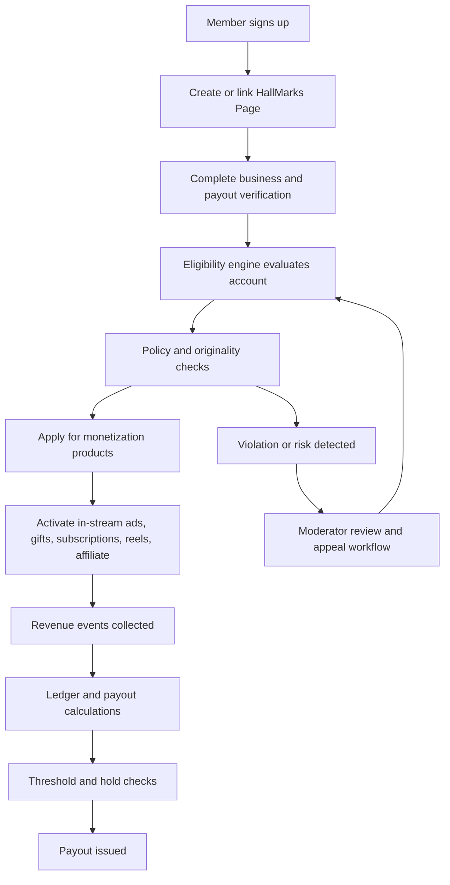

## 1. Product Overview
FingerMobile Business Suite is a full-stack creator and business operations console for HallMarks Pages, professional profiles, monetization, payouts, affiliate commerce, and compliance.
- It helps Members, creators, moderators, finance teams, and super admins manage eligibility, earnings, subscriptions, gifts, policies, payouts, verification, and performance from one secure dashboard.
- The product creates business value by turning audience activity into structured revenue while enforcing policy, fraud prevention, and administrative controls.

## 2. Core Features

### 2.1 User Roles
| Role | Registration Method | Core Permissions |
|------|---------------------|------------------|
| Member | Email and password | Manage profile, create HallMarks Page, view eligibility, apply for monetization, manage subscriptions and payouts |
| Creator | Member upgrade after HallMarks ownership | Publish content, view monetization insights, enable products, receive gifts and subscriptions |
| Moderator | Admin invitation | Review flagged content, issue compliance actions, monitor abuse and appeals |
| Finance Admin | Admin invitation | Manage payout configs, thresholds, settlement windows, currency and RPM rules |
| Business Admin | Admin invitation | Verify businesses, approve HallMarks Page settings, review identity and tax setup |
| Super Admin | Seeded platform admin | Configure monetization rules, subscription pricing, countries, policies, security controls, and global feature flags |

### 2.2 Feature Module
1. **Executive dashboard**: revenue summary, eligibility status, policy health, content performance, payout pipeline
2. **Monetization center**: in-stream ads, gifts, subscriptions, reels/content monetization, affiliate monetization, application workflows
3. **HallMarks management**: create/manage HallMarks Pages, assign page admins, track free-trial and subscription lifecycle
4. **Verification and compliance**: business verification, payout KYC, policy acknowledgements, violation history, appeals
5. **Revenue and payouts**: earnings ledger, minimum payout threshold, bank account linking, payout schedule, reserves and holds
6. **Affiliate commerce**: affiliate partners, conversion tracking, commission calculation, disclosure requirements
7. **Admin control center**: platform settings, fee structures, country support, payout rules, risk flags, webhooks, audit logs
8. **Policy and support**: Partner Monetization Policies page, policy details by program, resolution guidance, maintenance and monitoring views

### 2.3 Page Details
| Page Name | Module Name | Feature description |
|-----------|-------------|---------------------|
| Overview | Business health | Displays total revenue, pending payouts, risk score, monetization products, and quick actions |
| Overview | Eligibility cards | Shows pass/fail/pending state for each monetization product with reasons and next actions |
| Monetization Center | Program catalog | Lists In-Stream Ads, Gifts, FingerMobile Subscriptions, Ads on Reels, Affiliate Partnerships |
| Monetization Center | Eligibility engine | Calculates thresholds from followers, watch time, engagement, account age, age, country, originality, and policy health |
| Monetization Center | Earnings estimator | Uses RPM, CPM, CPC, CTR, CPV, ROI, AOV, conversion and view formulas for forward estimates |
| HallMarks Pages | Lifecycle manager | Creates HallMarks Pages, tracks two-year free period, transitions to billed plan, and changes visibility/access |
| HallMarks Pages | Admin settings | Manages page details, team roles, monetization access, content defaults, and moderation routing |
| Verification | Business verification | Tracks legal name, business number, address, identity status, review outcome, and evidence uploads |
| Verification | Payout setup | Captures bank details, tax information, payout schedule, minimum threshold, and payout holds |
| Revenue | Ledger | Records gross revenue, platform fee, reserve, taxes, net earnings, and settlement status |
| Revenue | Payouts | Lists payouts, statuses, destination bank, hold reasons, schedule windows, and downloadable statements |
| Affiliate Hub | Partners | Shows partner catalog, commission bands, conversion windows, approved markets, and disclosure rules |
| Affiliate Hub | Tracking | Tracks clicks, conversions, attributed sales, commissions, and performance bonus logic |
| Policy Center | MonetizationPolicyPage | Publishes FingerMobile Partner Monetization Policies and Content Monetization Policies adapted from Meta-style rules |
| Admin Console | Platform config | Controls fees, thresholds, supported countries, age minimum, payout minimum, policy versions, and risk settings |
| Admin Console | Monitoring | Shows webhook deliveries, suspicious activity, payout failures, moderation queues, and audit events |

## 3. Core Process
Members create or claim a HallMarks Page, complete profile and business verification, satisfy platform rules, and review monetization eligibility. The system continuously evaluates account, content, and audience quality against universal and product-specific criteria. Eligible users activate products, receive earnings into a ledger, and are paid after threshold, policy, and payout checks pass. Admins manage global rules, investigate abuse, and maintain policy integrity.

## 4. User Interface Design
### 4.1 Design Style
- Primary colors: midnight navy, cloud white, emerald success, amber warning, coral risk
- Button style: rounded large controls with compact secondary ghost actions
- Font and sizes: editorial display heading paired with readable sans serif body; dense dashboard hierarchy with compact metric tiles
- Layout style: desktop-first operations console with left rail navigation, top command strip, metric grid, and side detail drawers
- Icon style suggestions: clean line icons, policy status chips, finance badges, and trend markers

### 4.2 Page Design Overview
| Page Name | Module Name | UI Elements |
|-----------|-------------|-------------|
| Overview | KPI header | Revenue counters, trend chips, payout alerts, and task queue cards |
| Overview | Program cards | Threshold meters, eligibility reasons, action buttons, and policy badges |
| Monetization Center | Calculator | Metric inputs, formula explanations, scenario table, and earnings outputs |
| HallMarks Pages | Page profile | Branding panel, subscription timer, team members, and monetization access controls |
| Verification | KYC forms | Stepper, upload slots, review badges, and evidence history |
| Revenue | Ledger explorer | Filter bar, tabs, statement cards, payout timeline, and hold explanations |
| Affiliate Hub | Conversion dashboard | Click funnel, commission table, partner cards, and performance bonus panel |
| Policy Center | Policy article | Long-form structured content, alert banners, glossary, appeal steps, and acknowledgements |
| Admin Console | Config panels | Forms, tables, toggles, webhook viewer, audit stream, and environment badges |

### 4.3 Responsiveness
Desktop-first with tablet adaptation and mobile-safe navigation. Dense data views collapse into stacked cards, drawers replace side panels, and tables degrade into segmented summaries.

### 4.4 Page Design Documentation
- Navigation groups: Overview, HallMarks, Monetization, Verification, Revenue, Affiliate, Policy, Admin
- Primary call-to-actions: Create HallMarks Page, Verify Business, Link Bank, Apply for Monetization, Review Policy, Configure Platform
- Required empty states: no HallMarks, not verified, not eligible, payout threshold not met, no revenue yet, no affiliate partners yet
- Required alert states: policy warning, payout hold, identity rejected, webhook failed, suspicious engagement detected, country unsupported
