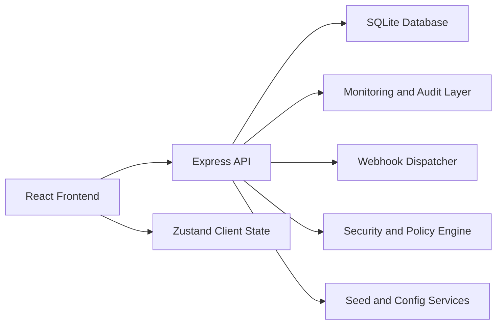
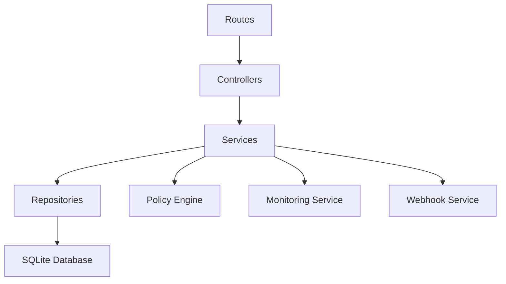
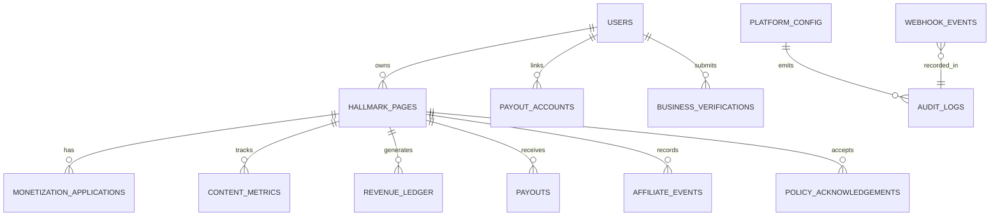

## 1. Architecture Design


## 2. Technology Description
- Frontend: React 18 + TypeScript + Vite + Tailwind CSS + React Router + Zustand + lucide-react
- Initialization Tool: `vite-init`
- Backend: Express 4 + TypeScript + modular service architecture
- Database: SQLite for local delivery, schema-first SQL migrations, seed data for demo readiness
- Testing: Vitest for UI and utilities, API verification with curl-based checks, TypeScript validation with `npm run check`
- Monitoring: health endpoint, structured audit events, webhook event tracking, risk and payout failure summaries

## 3. Route Definitions
| Route | Purpose |
|-------|---------|
| / | Business Suite overview dashboard |
| /hallmarks | HallMarks Pages management |
| /monetization | Monetization center and product eligibility |
| /verification | Business, KYC, and payout verification |
| /revenue | Ledger, payouts, and calculators |
| /affiliate | Affiliate partners, tracking, and commissions |
| /policy | MonetizationPolicyPage with policy content |
| /admin | Super admin operational console |

## 4. API Definitions
### Shared Types
```ts
type ProductKey =
  | "in_stream_ads"
  | "gifts"
  | "subscriptions"
  | "reels_ads"
  | "affiliate";

type EligibilityStatus = "eligible" | "warning" | "blocked" | "pending";

interface MonetizationMetrics {
  followers: number;
  watchMinutes60d: number;
  watchMinutes30d: number;
  postEngagement30d: number;
  returningViewers30d: number;
  uniqueViews30d: number;
  activeVideos: number;
  consecutiveFollowerDays: number;
  accountAgeDays: number;
  age: number;
  isEligibleCountry: boolean;
  originalContentScore: number;
  policyViolations: number;
  giftPurchaseEligible: boolean;
  verifiedBusiness: boolean;
  verifiedPayout: boolean;
}

interface EligibilityResult {
  product: ProductKey;
  status: EligibilityStatus;
  passedRules: string[];
  failedRules: string[];
  nextActions: string[];
}
```

### Endpoints
| Method | Endpoint | Purpose |
|--------|----------|---------|
| GET | /api/overview | Dashboard summary, alerts, and KPI data |
| GET | /api/hallmarks | List HallMarks Pages and billing lifecycle |
| POST | /api/hallmarks | Create HallMarks Page |
| PATCH | /api/hallmarks/:id | Update HallMarks details, access, and settings |
| GET | /api/monetization/eligibility | Calculate universal and product-specific eligibility |
| POST | /api/monetization/applications | Submit monetization application |
| GET | /api/monetization/programs | Return product catalog and requirement copy |
| POST | /api/monetization/estimate | Calculate earnings projections from formula inputs |
| GET | /api/verification/status | Return business, identity, and payout verification states |
| POST | /api/verification/business | Submit or update business verification |
| POST | /api/verification/payout-account | Submit payout account details |
| GET | /api/revenue/ledger | Return revenue ledger entries |
| GET | /api/revenue/payouts | Return payout history and threshold status |
| GET | /api/affiliate/partners | Return affiliate partner catalog and rates |
| GET | /api/affiliate/performance | Return click, conversion, and commission analytics |
| GET | /api/policy/monetization | Return FingerMobile policy content and version info |
| GET | /api/admin/config | Return global monetization config |
| PATCH | /api/admin/config | Update thresholds, fees, and platform settings |
| GET | /api/admin/monitoring | Return monitoring, audit, and webhook status |
| POST | /api/webhooks/events | Accept internal event/webhook deliveries |
| GET | /api/health | Health check |

### Example Request and Response
```ts
interface EligibilityResponse {
  universalStatus: EligibilityStatus;
  products: EligibilityResult[];
  metrics: MonetizationMetrics;
}

interface EstimateRequest {
  qualifyingViews: number;
  rpm: number;
  impressions: number;
  cpm: number;
  grossAdRevenue: number;
  revenueSharePercentage: number;
  totalClicks: number;
  cpc: number;
  totalRevenueGenerated: number;
  totalOrders: number;
  totalProductionCosts: number;
  productLinkClicks: number;
  contentPurchases: number;
  totalViews: number;
  totalWatchTimeMinutes: number;
  totalVideoLengthMinutes: number;
}
```

## 5. Server Architecture Diagram


## 6. Data Model
### 6.1 Data Model Definition


### 6.2 Data Definition Language
```sql
CREATE TABLE users (
  id TEXT PRIMARY KEY,
  full_name TEXT NOT NULL,
  email TEXT NOT NULL UNIQUE,
  role TEXT NOT NULL,
  age INTEGER NOT NULL,
  country_code TEXT NOT NULL,
  account_age_days INTEGER NOT NULL,
  created_at TEXT NOT NULL
);

CREATE TABLE hallmark_pages (
  id TEXT PRIMARY KEY,
  owner_user_id TEXT NOT NULL,
  name TEXT NOT NULL,
  description TEXT NOT NULL,
  followers_count INTEGER NOT NULL DEFAULT 0,
  visibility TEXT NOT NULL DEFAULT 'private',
  free_until TEXT NOT NULL,
  billing_plan TEXT NOT NULL DEFAULT 'free_trial',
  verified_business INTEGER NOT NULL DEFAULT 0,
  created_at TEXT NOT NULL,
  FOREIGN KEY (owner_user_id) REFERENCES users(id)
);

CREATE TABLE content_metrics (
  id TEXT PRIMARY KEY,
  hallmark_page_id TEXT NOT NULL,
  watch_minutes_60d INTEGER NOT NULL DEFAULT 0,
  watch_minutes_30d INTEGER NOT NULL DEFAULT 0,
  post_engagement_30d INTEGER NOT NULL DEFAULT 0,
  returning_viewers_30d INTEGER NOT NULL DEFAULT 0,
  unique_views_30d INTEGER NOT NULL DEFAULT 0,
  active_videos INTEGER NOT NULL DEFAULT 0,
  consecutive_follower_days INTEGER NOT NULL DEFAULT 0,
  original_content_score REAL NOT NULL DEFAULT 100,
  policy_violations INTEGER NOT NULL DEFAULT 0,
  gift_purchase_eligible INTEGER NOT NULL DEFAULT 0,
  updated_at TEXT NOT NULL,
  FOREIGN KEY (hallmark_page_id) REFERENCES hallmark_pages(id)
);

CREATE TABLE monetization_applications (
  id TEXT PRIMARY KEY,
  hallmark_page_id TEXT NOT NULL,
  product_key TEXT NOT NULL,
  status TEXT NOT NULL,
  submitted_at TEXT NOT NULL,
  decision_notes TEXT NOT NULL DEFAULT '',
  FOREIGN KEY (hallmark_page_id) REFERENCES hallmark_pages(id)
);

CREATE TABLE payout_accounts (
  id TEXT PRIMARY KEY,
  user_id TEXT NOT NULL,
  bank_name TEXT NOT NULL,
  account_last4 TEXT NOT NULL,
  currency TEXT NOT NULL,
  verified INTEGER NOT NULL DEFAULT 0,
  created_at TEXT NOT NULL,
  FOREIGN KEY (user_id) REFERENCES users(id)
);

CREATE TABLE revenue_ledger (
  id TEXT PRIMARY KEY,
  hallmark_page_id TEXT NOT NULL,
  product_key TEXT NOT NULL,
  gross_amount REAL NOT NULL,
  platform_fee REAL NOT NULL,
  reserve_amount REAL NOT NULL,
  tax_amount REAL NOT NULL,
  net_amount REAL NOT NULL,
  settlement_status TEXT NOT NULL,
  occurred_at TEXT NOT NULL,
  FOREIGN KEY (hallmark_page_id) REFERENCES hallmark_pages(id)
);

CREATE TABLE payouts (
  id TEXT PRIMARY KEY,
  hallmark_page_id TEXT NOT NULL,
  payout_account_id TEXT NOT NULL,
  amount REAL NOT NULL,
  status TEXT NOT NULL,
  scheduled_for TEXT NOT NULL,
  paid_at TEXT,
  hold_reason TEXT NOT NULL DEFAULT '',
  FOREIGN KEY (hallmark_page_id) REFERENCES hallmark_pages(id),
  FOREIGN KEY (payout_account_id) REFERENCES payout_accounts(id)
);

CREATE TABLE business_verifications (
  id TEXT PRIMARY KEY,
  user_id TEXT NOT NULL,
  legal_name TEXT NOT NULL,
  registration_number TEXT NOT NULL,
  country_code TEXT NOT NULL,
  review_status TEXT NOT NULL,
  submitted_at TEXT NOT NULL,
  FOREIGN KEY (user_id) REFERENCES users(id)
);

CREATE TABLE affiliate_events (
  id TEXT PRIMARY KEY,
  hallmark_page_id TEXT NOT NULL,
  partner_name TEXT NOT NULL,
  clicks INTEGER NOT NULL DEFAULT 0,
  conversions INTEGER NOT NULL DEFAULT 0,
  commission_amount REAL NOT NULL DEFAULT 0,
  attribution_window_days INTEGER NOT NULL DEFAULT 7,
  recorded_at TEXT NOT NULL,
  FOREIGN KEY (hallmark_page_id) REFERENCES hallmark_pages(id)
);

CREATE TABLE platform_config (
  id TEXT PRIMARY KEY,
  minimum_age INTEGER NOT NULL DEFAULT 22,
  minimum_payout_threshold REAL NOT NULL DEFAULT 100,
  hallmark_monthly_fee REAL NOT NULL DEFAULT 19.99,
  hallmark_yearly_fee REAL NOT NULL DEFAULT 199.00,
  revenue_share_percentage REAL NOT NULL DEFAULT 0.55,
  gifts_cash_value REAL NOT NULL DEFAULT 0.01,
  supported_countries_json TEXT NOT NULL,
  updated_at TEXT NOT NULL
);

CREATE TABLE webhook_events (
  id TEXT PRIMARY KEY,
  event_type TEXT NOT NULL,
  payload_json TEXT NOT NULL,
  status TEXT NOT NULL,
  received_at TEXT NOT NULL
);

CREATE TABLE audit_logs (
  id TEXT PRIMARY KEY,
  actor_id TEXT NOT NULL,
  action TEXT NOT NULL,
  target_type TEXT NOT NULL,
  target_id TEXT NOT NULL,
  metadata_json TEXT NOT NULL,
  created_at TEXT NOT NULL
);

CREATE TABLE policy_acknowledgements (
  id TEXT PRIMARY KEY,
  user_id TEXT NOT NULL,
  policy_key TEXT NOT NULL,
  policy_version TEXT NOT NULL,
  accepted_at TEXT NOT NULL,
  FOREIGN KEY (user_id) REFERENCES users(id)
);
```

## 7. Operational Concerns
- Security: input validation, centralized error handling, defensive defaults, no raw bank data exposure, admin-only config mutation, audit logging for critical actions
- Maintenance: seed data for demo environments, single config service, constants and formulas in shared modules, migration-first database updates
- Monitoring: health endpoint, monitoring dashboard data, webhook status, suspicious engagement indicators, payout hold reporting
- Dependencies: keep external services optional; use local mock data and SQLite to make the suite runnable immediately in a sandbox
