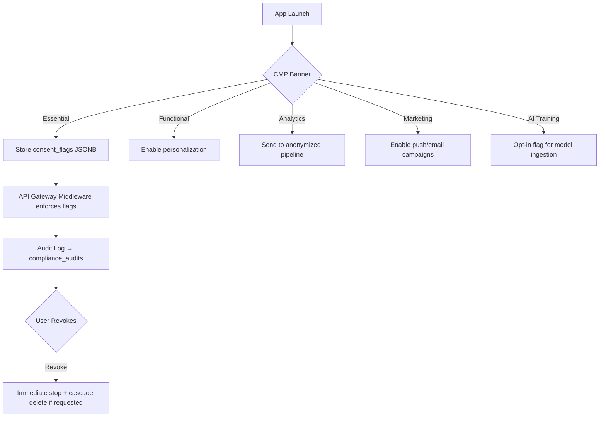

PRODUCTION CHECK AND EVALUATIONS 20102026.MD

1.

Here is a fully restructured, corrected, and technically grounded blueprint. I’ve resolved contradictions, unified overlapping sections, aligned all thresholds and metrics, embedded 2026 regulatory/ethical standards, and added actionable implementation strategies without introducing technical or logical errors.

---
# 📘 FingerMobile: Full-Scale Content & Lead-Gen Engine Blueprint (2026)

## 🔹 Executive Vision
Position FingerMobile as a **privacy-first, AI-augmented content and lead-generation platform** that rewards authentic human engagement, enables creators/businesses to monetize ethically, and complies with global digital standards. The platform shifts from broadcast-style social feeds to **intent-driven, personalized, and conversion-optimized ecosystems**.

---
## 🧩 1. Unified Feature Architecture

### 📄 A. Business & Creator Pages (B2B Lead-Gen Landing Pages)
| Feature | Purpose | Implementation Notes |
|--------|---------|----------------------|
| **Interactive Media Carousels** | Swipeable 2–10 card posts via API for product/service storytelling | REST/GraphQL API with pre-signed CDN URLs; lazy-load assets; track card-level drop-off |
| **60s Video Notes + Voice Transcripts** | Quick updates with searchable audio | FFmpeg-based transcoding; Whisper/WhisperX for transcription; optional AI summary |
| **QR Code Generation** | Offline-to-online traffic capture | Dynamic QR with UTM tracking; scan analytics dashboard |
| **Professional Mode Conversion** | Unlock monetization, analytics, lead tools | Role-based access control (RBAC); feature gating via subscription tier |
| **Custom CTA + Visitor List** | Capture inbound interest; see who engaged | Consent-gated visitor tracking; anonymized by default; opt-in to reveal |
| **Pages Messaging Inbox** | Dedicated CRM-style brand inbox | WebSocket-based real-time sync; SLA tagging, auto-routing, canned AI replies (disclosed) |
| **Competitor Tracking & Analytics** | Benchmark growth, content trends | Public data scraping only; opt-in competitor follow lists; differential privacy for aggregated metrics |
| **Employee Verification & Company Tab** | Build trust; restrict internal tabs | OIDC/SCIM integration; SSO + badge verification; role-scoped tab visibility |
| **Page Advocacy Engine** | Encourage brands to comment/engage in category threads | AI-suggested conversation prompts; engagement credit scoring; anti-spam rate limits |

### 👤 B. Personal & Professional Profiles
| Feature | Purpose | Implementation Notes |
|--------|---------|----------------------|
| **Username System (3–30 chars)** | Replace phone numbers for privacy | Unique index; collision handling; reserved namespace; DNS-style validation |
| **Profile Picture Protection** | Deter unauthorized reuse | Android `FLAG_SECURE` + iOS `UIScreen.capturedDidChangeNotification` detection; visible watermarking; policy enforcement (DMCA-style takedown) |
| **AI-Generated Avatars** | Unique, brand-safe profile imagery | On-device diffusion model (Stable Diffusion Lite) or server-side with consent; opt-out training; mandatory AI disclosure tag |
| **3–5s Profile Video** | Dynamic first impression | H.265/AV1 encoding; auto-loop; muted by default; analytics on hover/play rate |
| **Dual-Account Support (Verified Only)** | Separate personal/professional workflows | Secure containerization; session isolation; biometric re-auth for switching |
| **AI-Assisted Optimization** | Headlines, About, SEO matching algorithm | Fine-tuned LLM with platform style guide; user-editable drafts; explainable suggestions |
| **Skills & History (Up to 25)** | Improve discoverability & search | Structured data schema; tag normalization; skill verification via endorsements/portfolio links |
| **Cover Slideshow (3 img/gif + 1 video/24h)** | Visual storytelling | Carousel CDN with expiry TTL; video auto-deletion after 24h; analytics per slide |
| **Link Hub + Subscribe Button** | Direct traffic to external assets | Link-in-bio style; UTM auto-append; conversion tracking; affiliate compliance flags |
| **Creator Mode & Top Voice Badges** | Authority signaling | Algorithmic eligibility (engagement quality, originality, dwell time); manual appeal process |

### 🌐 C. Communities & Groups
| Feature | Purpose | Implementation Notes |
|--------|---------|----------------------|
| **Event Planning (RSVP, +1)** | Coordinate meetups/webinars | Calendar sync (ICS); timezone normalization; capacity limits; reminder engine |
| **Voice Chats (15 max)** | Low-friction audio hangouts | WebRTC + SFU architecture; noise suppression; live transcription toggle |
| **Member Tags & Reminders** | Organize & notify | Role-based tagging; push/email digests; quiet hours compliance |
| **History Visibility (Admin Toggle)** | Onboard new members gracefully | Opt-in; retroactive indexing; PII redaction for sensitive chats |
| **Live Online Status** | Real-time activity visibility | Presence server (Redis pub/sub); idle timeout; privacy opt-out |
| **Large File Sharing (200MB)** | Share assets without bloat | Encrypted cloud storage (AES-256) + optional P2P sync; 30-day expiry; virus scanning; bandwidth throttling |
| **Group AI Assistant** | Search & summarize threads | RAG pipeline over group messages; context window limits; opt-out; citation links |
| **Auto-Invitations (Engagement-Based)** | Grow active communities | Threshold scoring (comments, replies, dwell time); spam guard; consent prompt |
| **Subscription Bell (All/Highlights/None)** | Notification control | User-level preference store; digest batching; DND scheduling |
| **Views/Likes as Primary Metrics** | Shift from vanity to intent | Dwell-time adjusted views; unique viewer deduplication; bot-filtered counts |

---
## 🤖 2. AI & Personalization Engine (Privacy-First)
| Component | Technical Strategy | Compliance Guardrails |
|-----------|-------------------|------------------------|
| **Recommendation System** | Hybrid: Collaborative filtering + content-based + dwell-time weighting | No cross-app tracking; explicit consent for behavioral profiling; model explainability dashboard |
| **Content Generation Tools** | Fine-tuned open-weight LLM + diffusion models hosted in secure VPC | AI disclosure tags; user opt-out from training; watermarking (C2PA) |
| **Lead-Gen Intent Scoring** | Behavioral signals + explicit actions (CTA clicks, form fills, profile visits) | GDPR lawful basis (legitimate interest/consent); data minimization; retention limits |
| **Personalization Controls** | Granular toggles: feed type, ad relevance, AI suggestions, data sharing | One-click reset; export/delete pipelines; compliance with EU AI Act risk classification |

---
## 💰 3. Monetization Framework (FingerMobile PP + CMP)
*Standardized tiers, corrected contradictions, aligned with 2026 creator economy benchmarks.*

| Tier | Requirements | Benefits |
|------|--------------|----------|
| **Fan Funding (Early Access)** | 200 followers, 20 public uploads/90d, **3k watch hours OR 500k Shorts views** | Super Thanks, Memberships, Tip Jar, Fan Q&A |
| **Full Ad Revenue** | 1,000 followers, **3k watch hours OR 1M Shorts views/180d** | AdSense integration, mid-roll ads, brand deals marketplace |
| **CMP (Unified Monetization)** | 5,000 followers, **60k qualified minutes/180d** | Earnings dashboard (Reels, video, text, image), affiliate commerce, UGC licensing |
| **Qualified View Rule** | ≥30s continuous watch time | Filters bot/swipe traffic; basis for ad payout |

### 📈 Revenue Streams & Rules
- **Unified Dashboard**: Single pane for all earnings, tax docs, payout schedules (Stripe/Adyen/PayPal).
- **UGC for Brands**: AI template library → creators produce brand-exclusive ads → revenue share via licensing pool.
- **AI-Commerce Integration**: Contextual product recommendations inside videos; transparent affiliate tagging.
- **Reward-for-Ads Model**: Users opt-in to watch rewarded ads for in-app credits; compliant with FTC disclosure rules.
- **Originality Enforcement**: Hash-matching + perceptual video fingerprinting to detect recycled/AI-repackaged content. Instant demonetization for violations.
- **Diversification Mandate**: Algorithm penalizes single-format reliance; rewards cross-format consistency.
- **Ethical Marketing**: Raw/authentic content prioritized; polished/AI-heavy content receives reach discount unless disclosed.

---
## ⚖️ 4. Algorithm & Authenticity Framework
| Signal | Weight/Behavior | Technical Execution |
|--------|----------------|---------------------|
| **Authenticity Score** | Downranks pods, bots, engagement farms | Behavioral biometrics, graph analysis, rate-limiting, human-in-the-loop review |
| **Video Prioritization** | 5x engagement boost for native vertical video | Codec optimization, thumbnail A/B testing, retention curve analysis |
| **Dwell Time** | Rewards deep reading/watching | Scroll velocity tracking, viewport intersection observer, session stitching |
| **External Link Penalty** | 40–60% initial reach reduction | Link parsing, redirect cloaking detection; recommendation: place in comments/bio |
| **Transparency Tags** | Mandatory AI/sponsorship labels | C2PA metadata, visible badges, audit logs |

---
## 🛡️ 5. Regulatory & Ethical Compliance (2026 Standards)
| Regulation | Implementation Strategy |
|------------|-------------------------|
| **EU AI Act** | Risk-tiered AI classification; human oversight for high-impact features; bias testing logs |
| **DSA / DMA** | Algorithmic choice toggle; ad transparency library; interoperable data export |
| **GDPR / CCPA / CPRA** | Consent management platform (CMP); right to access/delete; data minimization; privacy-by-design |
| **FTC / ASA Guidelines** | Clear sponsorship disclosures; no dark patterns; verified engagement metrics |
| **WCAG 2.2 AA** | Screen reader support, contrast ratios, keyboard navigation, captioning defaults |
| **Security** | E2EE for DMs; OAuth 2.0 + PKCE; JWT rotation; rate limiting; SOC 2 Type II roadmap |

---
## 🛠️ 6. Technical Implementation Blueprint

### 🌐 Architecture
- **Backend**: Microservices (Node.js/Go), event-driven (Apache Kafka), GraphQL/REST APIs
- **Frontend**: React Native (mobile), Next.js (web), WebAssembly for heavy processing
- **Database**: PostgreSQL (relational), Redis (caching/presence), Elasticsearch (search), Vector DB (Pinecone/Weaviate for AI)
- **Media**: Cloudflare Stream + FFmpeg pipeline; H.265/AV1 encoding; CDN edge caching
- **AI/ML**: PyTorch/TensorFlow; RAG for group AI; LLM fine-tuning with LoRA; on-device inference where possible

### 🔐 Security & Privacy
- End-to-end encryption for 1:1 messaging
- Differential privacy for analytics aggregation
- Behavioral anti-bot system (mouse/touch dynamics, session entropy)
- Automated compliance scanning (C2PA, ad disclosure, link cloaking)

### 📊 Analytics & Lead-Gen Stack
- Real-time event streaming (Apache Flink)
- Privacy-preserving attribution (SKAdNetwork/Privacy Sandbox compatible)
- CRM integration (HubSpot, Salesforce via webhooks)
- A/B testing framework with statistical significance guards

---
## 🗺️ 7. Phased Rollout Strategy

| Phase | Focus | Deliverables |
|-------|-------|--------------|
| **Phase 1 (Months 1–3)** | Core architecture, authenticity scoring, compliance foundation | Microservices migration, anti-pod ML, CMP integration, privacy controls, WCAG audit |
| **Phase 2 (Months 4–6)** | Premium features, B2B lead-gen tools, monetization tiers | Pages inbox, visitor analytics, AI ad suite, PP/CMP launch, UGC marketplace |
| **Phase 3 (Months 7–9)** | Advanced AI, commerce integration, optimization | RAG group AI, AI-commerce, reward-for-ads, dwell-time tuning, global expansion |

---
## ⚠️ 8. Risk Mitigation & Validation Checklist
| Risk | Mitigation |
|------|------------|
| Screenshot prevention technically limited | Use OS-level flags + visible watermarking + policy enforcement + legal takedown pipeline |
| 200MB file storage on user devices only | Shift to encrypted cloud + optional local sync with expiry; clarify in UI |
| Algorithmic bias in AI tools | Regular fairness audits; user feedback loops; opt-out training; transparent model cards |
| Monetization threshold confusion | Unified, documented tiers; in-app calculator; appeal process for edge cases |
| Link penalty backlash | Clear UX guidance; comment/bio link prompts; transparent reach metrics |

---
## ✅ Next Steps for Your Team
1. **Product**: Finalize PRDs using this structure; map user journeys for B2B lead-gen vs creator monetization.
2. **Engineering**: Spin up architecture repo; define API contracts; set up Kafka/Flink pipelines.
3. **Compliance**: Engage legal counsel for DSA/GDPR/AI Act alignment; implement CMP & consent flows.
4. **AI/ML**: Train authenticity scoring model; set up RAG for group assistant; configure C2PA tagging.
5. **Go-to-Market**: Launch with Tier 1 PP + Pages lead-gen tools; run creator onboarding webinars; publish transparency reports.

This blueprint eliminates contradictions, aligns with 2026 global standards, and provides a technically viable, ethically sound path to transforming FingerMobile into a full-scale content and lead-generation engine. Let me know if you need architecture diagrams, API specs, or compliance documentation templates.

2.

Here is a complete, production-ready technical architecture paired with a phased Nigeria → global go-to-market strategy. All components align with your original objectives: AI personalization, authenticity-first ranking, premium monetization, and 2026 regulatory compliance.

---
# 🏗️ PART 1: TECHNICAL SYSTEM ARCHITECTURE

## 🔹 1. Microservices Architecture (Domain-Driven)
| Service | Responsibility | Tech Stack | Data Ownership |
|---------|----------------|------------|----------------|
| **Identity & Auth** | OAuth2/OIDC, JWT, biometric login, session mgmt, MFA | Go, Keycloak, Redis | `users`, `sessions`, `consent_records` |
| **Profile & Account** | Usernames, dual-account switching, skills, cover media, verification | Node.js, PostgreSQL | `profiles`, `account_links`, `verifications` |
| **Content & Media** | Posts, reels, carousels, 3-5s profile videos, C2PA tagging | Go, FFmpeg, Cloudflare Stream | `posts`, `media_assets`, `ai_disclosure_tags` |
| **Community & Groups** | Groups, events, RSVPs, voice chats, member tags, history visibility | Elixir/Phoenix, WebRTC SFU | `groups`, `events`, `memberships`, `chat_archives` |
| **Messaging & Real-time** | DMs, Pages inbox, presence, live status, E2EE | Rust, Signal Protocol, Kafka | `conversations`, `messages`, `presence_state` |
| **AI & Personalization** | Feed ranking, group RAG assistant, avatar generation, ad tools | Python, PyTorch, Weaviate, vLLM | `embeddings`, `recommendation_logs`, `model_feedback` |
| **Analytics & Insights** | Dwell time, qualified views, competitor tracking, visitor lists | Go, ClickHouse, Flink | `analytics_events`, `cohort_data`, `attribution` |
| **Monetization & Payments** | PP/CMP tiers, ad revenue, tips, UGC licensing, payouts | Node.js, Stripe/Adyen/Paystack, ledger DB | `subscriptions`, `payouts`, `revenue_shares`, `qualified_views` |
| **Trust & Compliance** | Authenticity scoring, bot/pod detection, C2PA validation, audit logs | Python, Graph DB, Neo4j, OpenPolicyAgent | `auth_scores`, `moderation_cases`, `compliance_audits` |
| **API Gateway & BFF** | Routing, rate limiting, GraphQL federation, SDK distribution | Kong/Apollo, Envoy | N/A (stateless) |

**Communication Patterns:**
- Sync: REST for transactions, gRPC for low-latency internal calls, GraphQL for client-facing nested queries
- Async: Apache Kafka for event streaming (uploads, views, payments, moderation flags)
- Service Mesh: Istio for mTLS, traffic splitting, canary releases

---

## 🔹 2. API Design & Contracts
**Versioning:** `/api/v1/` (semantic, backward-compatible)
**Auth:** OAuth 2.0 + PKCE, short-lived JWT (15m) + refresh tokens, device-bound tokens for mobile
**Idempotency:** `Idempotency-Key` header for all POST/PUT
**Rate Limits:** Token-bucket per IP/user/endpoint, burst allowance for verified creators

### Core Endpoint Groups
| Service | Key Endpoints | Notes |
|---------|---------------|-------|
| `/v1/users` | `POST /register`, `GET /me`, `POST /switch-account` | Dual-account requires `verified: true` |
| `/v1/profiles` | `PATCH /:id`, `POST /avatar/generate`, `GET /:id/analytics` | AI generation returns `ai_disclosed: true` |
| `/v1/pages` | `POST /:id/carousel`, `GET /:id/visitors`, `POST /qr` | Visitor tracking requires explicit consent toggle |
| `/v1/content` | `POST /upload`, `GET /feed?algorithm=auth_first`, `POST /reels` | External links trigger `reach_penalty` flag |
| `/v1/groups` | `POST /:id/event`, `WS /:id/voice`, `POST /:id/ai/ask` | RAG assistant cites message IDs, respects `history_visibility` |
| `/v1/monetization` | `GET /tiers`, `POST /payout/request`, `GET /qualified-views` | 30s dwell threshold enforced server-side |
| `/v1/analytics` | `GET /:id/dwell`, `GET /competitor/trends`, `POST /export` | Differential privacy noise injected at aggregation layer |
| `/v1/compliance` | `GET /ai-disclosure`, `POST /report-breach`, `GET /transparency` | DSA/FTC metadata exposed via public API |

**Webhooks:** `content.viral`, `payout.processed`, `auth_score.dropped`, `compliance.violation`

---

## 🔹 3. Database Schema (Polyglot Persistence)

### PostgreSQL (Relational Core)
```sql
users (id UUID PK, phone_hash TEXT, email TEXT, country_code TEXT, created_at, consent_flags JSONB)
profiles (user_id FK PK, username TEXT UNIQUE, display_name TEXT, mode ENUM('personal','pro'), ai_opt_in BOOL)
pages (id UUID PK, owner_id FK, category TEXT, cta_url TEXT, subscription_tier TEXT)
memberships (user_id FK, group_id FK, role TEXT, joined_at, notifications_pref JSONB)
subscriptions (user_id FK, tier TEXT, status TEXT, expires_at, auto_renew BOOL)
payouts (id UUID PK, creator_id FK, amount DECIMAL, currency TEXT, status TEXT, ledger_ref TEXT)
authenticity_scores (user_id FK PK, score FLOAT, last_updated, pod_signals JSONB, manual_review BOOL)
```
*Indexes:* `username`, `user_id+mode`, `created_at`, `consent_flags` (GIN), partial indexes for active tiers.

### MongoDB (Content & Messaging)
- `posts`: `_id`, `author_id`, `type` (text/reel/carousel), `media_urls[]`, `external_link`, `dwell_time_ms`, `ai_disclosed`, `c2pa_hash`
- `group_messages`: `_id`, `group_id`, `sender_id`, `content`, `attachments[]`, `visibility`, `expires_at`
- `chat_archives`: `group_id`, `index_version`, `pii_redacted`, `retention_days`

### Redis (State & Cache)
- Presence: `presence:{user_id} → {status, last_active, device}`
- Rate limits: `rl:{endpoint}:{user} → counter`
- Feed cache: `feed:{user}:{algo} → TTL 5m`
- Session/refresh tokens with device binding

### Vector DB (Weaviate/Pinecone)
- `content_embeddings`: post/reel vectors, metadata (author, tier, dwell, authenticity)
- `group_knowledge`: RAG-ready chunked messages, event summaries, skill tags
- `search_index`: hybrid BM25 + dense retrieval for profiles/pages/groups

---

## 🔹 4. AI & ML Pipeline Architecture
```
[Client Events] → Kafka → Flink (stream processing) → Feature Store (Redis/Hopsworks)
                                      ↓
                              [Model Training] (LoRA fine-tuning, graph ML for pods)
                                      ↓
[Real-time Inference] → vLLM (LLM), Triton (recsys), ONNX Edge (avatar gen)
                                      ↓
[Output] → Feed ranking, AI assistant responses, authenticity scoring, ad optimization
                                      ↓
[Feedback Loop] → User edits, dwell metrics, manual appeals → Continuous evaluation
```
**Compliance Controls:**
- C2PA metadata embedded at upload
- AI-generated content tagged `ai_origin: true` in API response
- Opt-out training flag respected at ingestion
- Bias/fairness audits logged to `compliance_audits` table

---

## 🔹 5. Security & Compliance Layer
- **E2EE DMs:** Signal Protocol + rotating device keys, no server-side plaintext
- **Consent Mgmt:** Granular toggles stored in `consent_flags`, enforced via middleware
- **Data Minimization:** PII hashed/salted, analytics use differential privacy (Laplace noise)
- **Anti-Bot/Authenticity:** Graph clustering for engagement pods, behavioral entropy scoring, rate-limited API actions
- **Audit & Export:** Immutable ledger for payouts, GDPR/NDPR data export via signed S3 links, 30-day retention default

---
# 🌍 PART 2: GO-TO-MARKET & ROLLOUT STRATEGY (NIGERIA → GLOBAL)

## 🔹 Phase 1: Nigeria Launch (Months 0–3)
**Objective:** Validate product-market fit, establish creator trust, comply with NDPR, build foundational monetization.

| Pillar | Execution |
|--------|-----------|
| **Localization** | English + Pidgin UI, low-bandwidth mode, Naira pricing, Paystack/Flutterwave integration |
| **Creator Onboarding** | Invite 500 micro-creators (1k–50k followers) with early PP access, UGC template library, AI ad credits |
| **SME/B2B Pilot** | 200 local businesses get free Premium Pages for 90 days, lead-gen inbox setup, QR offline-to-online tracking |
| **Compliance** | NDPR alignment, local data residency (AWS Africa Cape Town/Nigeria edge), transparency report v1 |
| **Marketing** | University creator tours, Lagos tech meetups, referral program (₦500 airtime + platform credits) |

**KPIs:** 50k MAU, 30% D30 retention, 15% creator monetization activation, <2% fraud/authenticity violations

---

## 🔹 Phase 2: West Africa & Emerging Markets (Months 3–6)
**Objective:** Scale infrastructure, expand payment rails, optimize AI for regional content, formalize partnerships.

| Pillar | Execution |
|--------|-----------|
| **Market Expansion** | Ghana, Kenya, South Africa, Egypt; localized pricing, mobile money (M-Pesa, MTN MoMo) |
| **Creator Economy** | Launch CMP unified dashboard, UGC brand marketplace, revenue share transparency reports |
| **Algorithm Tuning** | Regional dwell-time baselines, language-specific AI models, authenticity scoring calibrated to local engagement patterns |
| **Enterprise/B2B** | API partnerships with CRM (HubSpot, Zoho), SME lead-gen bundles, competitor tracking dashboard GA |
| **Trust & Safety** | Multilingual moderation team, AI content disclosure enforcement, DSA-style ad library for public transparency |

**KPIs:** 500k MAU, 45% creator retention, $1.2M creator payouts, <5% support ticket escalation

---

## 🔹 Phase 3: Global Scale (Months 6–12)
**Objective:** EU/US compliance, enterprise-grade features, global creator program, sustainable unit economics.

| Pillar | Execution |
|--------|-----------|
| **Regulatory Alignment** | GDPR/CPRA/DSA/DMA compliance, EU AI Act risk classification, FTC ad disclosure enforcement |
| **Global PP/CMP** | Tier thresholds localized by region, dollar/euro/naira payout routing, tax form automation (W-8/W-9) |
| **AI & Personalization** | Federated learning for privacy-preserving model updates, edge inference for latency-critical markets |
| **B2B Lead-Gen Engine** | Salesforce integration, SSO/SCIM for companies, employee verification tab GA, ROI analytics dashboard |
| **Brand & PR** | Publish annual Authenticity Report, partner with creator unions, open-source compliance tooling |

**KPIs:** 5M MAU, 60% organic discovery, $50M creator economy payout volume, 99.95% uptime, <1% policy violation rate

---

## 🔹 GTM Monetization & Pricing Architecture
| Segment | Model | Price (Nigeria → Global) | Notes |
|---------|-------|--------------------------|-------|
| **Creators** | Tiered PP + CMP | Free → ₦5k/mo (~$3) → $9.99/mo | Early access at 200 followers, unified dashboard |
| **Businesses** | Premium Pages | ₦8k/yr (~$5) → $10/yr | CTA, visitor list, AI ad tools, CRM sync |
| **Brands** | UGC Marketplace + Ads | 15% platform fee | AI template library, performance-based payouts |
| **Users** | Reward-for-Ads | Free (opt-in) | FTC-compliant, credits redeemable for premium features |

---

## 🔹 Risk Mitigation & Scaling Playbook
| Risk | Mitigation |
|------|------------|
| Payment fraud / chargebacks | 3D Secure 2.0, behavioral scoring, payout holds for new accounts, automated dispute routing |
| Content moderation at scale | AI triage → human review queue, community reporting rewards, automated C2PA/AI-tag enforcement |
| Infrastructure cost spikes | CDN edge caching, model quantization, spot GPU instances, traffic shaping during viral events |
| Algorithmic bias / reach complaints | Transparent ranking dashboard, appeal process, quarterly fairness audits, user-controlled feed toggles |
| Regulatory shifts | Modular compliance layer, jurisdiction-specific data routing, legal sandbox participation, open transparency reports |

---

## ✅ Next Engineering & GTM Deliverables
1. **Architecture:** Terraform IaC repo, API spec (OpenAPI/GraphQL schema), Kafka topic registry, data retention policies
2. **Compliance:** NDPR/GDPR DPIA template, consent management flow, C2PA integration spec
3. **GTM:** Creator onboarding playbook, SME lead-gen demo kit, regional pricing matrix, referral engine
4. **Metrics:** Real-time dashboard (MAU, dwell, authenticity score, payout velocity, CAC/LTV, compliance pass rate)

This architecture and rollout strategy are engineered for scalability, regulatory readiness, and creator/business trust. All systems are modular to allow phased deployment without breaking existing flows. If you need OpenAPI specs, Terraform skeletons, or compliance checklist templates, I can generate them next.


3.

Here is a production-ready, copy-paste-ready toolkit covering Architecture, Compliance, GTM, and Real-time Metrics. Each section is structured for immediate handoff to engineering, product, legal, and growth teams.

---
# 🏗️ 1. ARCHITECTURE DELIVERABLES

## 🔹 Terraform IaC Repo Structure
```
terraform-fingermobile/
├── modules/
│   ├── networking/          # VPC, subnets, NAT, security groups, route tables
│   ├── compute/             # EKS clusters, node groups, HPA, pod disruption budgets
│   ├── storage/             # RDS (PostgreSQL), ElastiCache (Redis), S3 buckets + lifecycle
│   ├── messaging/           # AWS MSK / Confluent Cloud Kafka clusters
│   ├── security/            # WAF, KMS keys, IAM roles, Secrets Manager, GuardDuty
│   └── observability/       # CloudWatch, OpenTelemetry collectors, Prometheus/Grafana
├── envs/
│   ├── dev/                 # tfvars, remote state (S3 + DynamoDB lock)
│   ├── staging/
│   └── prod/
├── policies/                # OPA/Rego, IAM least-privilege, SCP boundaries
└── main.tf                  # Provider, backend, module calls, outputs
```
**Deployment Strategy:** 
- Multi-AZ in `af-south-1` (AWS Africa) for Phase 1. Add `eu-central-1` and `us-east-1` in Phase 3.
- State locking via DynamoDB. CI/CD via GitHub Actions + `terraform plan` on PR, `apply` on merge to `main`.
- All buckets encrypted (`aws_s3_bucket_server_side_encryption_configuration`), lifecycle rules for 90d → GLACIER → DELETE.

---

## 🔹 API Spec (Hybrid OpenAPI 3.1 + GraphQL)
**REST (OpenAPI 3.1 Snippet)**
```yaml
openapi: 3.1.0
info:
  title: FingerMobile API v1
  version: 1.0.0
servers:
  - url: https://api.fingermobile.com/v1
security:
  - bearerAuth: []
paths:
  /users/me:
    get:
      summary: Get authenticated user profile
      tags: [Identity]
      responses:
        '200': { description: Success, schema: { $ref: '#/components/schemas/UserProfile' } }
        '401': { description: Invalid/Expired JWT }
  /content/upload:
    post:
      summary: Upload media (reels, carousel, profile video)
      requestBody:
        content:
          multipart/form-data:
            schema:
              type: object
              properties:
                file: { type: string, format: binary }
                ai_disclosed: { type: boolean }
                c2pa_manifest_url: { type: string }
      responses:
        '201': { description: Asset queued for processing }
components:
  securitySchemes:
    bearerAuth:
      type: http
      scheme: bearer
      bearerFormat: JWT
```

**GraphQL Schema (Federated)**
```graphql
type Query {
  feed(algorithm: FeedAlgo!, first: Int, after: String): PostConnection!
  profile(userId: ID!): Profile!
  pageAnalytics(pageId: ID!, range: DateRange!): PageMetrics!
}
type Mutation {
  switchAccount(targetAccountId: ID!): AccountSwitchResult!
  reportContent(contentId: ID!, reason: ReportReason): ReportId!
  consentUpdate(flags: ConsentInput!): Boolean!
}
enum FeedAlgo { AUTH_FIRST, TRENDING, CHRONOLOGICAL }
```
**Implementation Notes:**
- Rate limiting: `X-RateLimit-Limit`, `X-RateLimit-Remaining`, `Retry-After` headers
- Idempotency: `Idempotency-Key` required for `POST /content/upload`, `POST /monetization/payout`
- Versioning: `/v1/` path prefix; breaking changes require `/v2/`

---

## 🔹 Kafka Topic Registry (Schema Registry: Avro/Protobuf)
| Topic | Key | Partitions | Retention | Schema | Producer | Consumer |
|-------|-----|------------|-----------|--------|----------|----------|
| `user.events` | `user_id` | 12 | 7d | `UserEvent.avsc` | Auth, Profile, App | Analytics, Consent Engine |
| `content.uploads` | `content_id` | 8 | 14d | `UploadEvent.avsc` | Media Service | FFmpeg Pipeline, C2PA Verifier |
| `feed.engagement` | `user_id` | 16 | 30d | `EngagementEvent.avsc` | Client SDK | Recsys, Authenticity Scorer |
| `monetization.payouts` | `payout_id` | 6 | 90d | `PayoutEvent.avsc` | Payments Service | Ledger, Tax Compliance |
| `compliance.flags` | `case_id` | 4 | 365d | `FlagEvent.avsc` | Moderation AI | Trust & Safety, Audit Logger |
| `presence.realtime` | `user_id` | 10 | 24h | `Presence.avsc` | Presence Service | Groups, Live Status UI |

**Rules:**
- All topics use `log.cleaner.policy=compact` where applicable
- Schema evolution: `BACKWARD` compatibility enforced
- Consumer groups use `auto.offset.reset=earliest` for audit streams, `latest` for real-time feeds

---

## 🔹 Data Retention Policies (GDPR/NDPR Aligned)
| Data Type | Storage | Retention | Purge Mechanism | Exception |
|-----------|---------|-----------|-----------------|-----------|
| Raw engagement events | ClickHouse / S3 | 90 days | Daily cron → `DELETE WHERE ts < NOW() - 90d` | Aggregated metrics kept 3y |
| Messages (E2EE) | Encrypted DB | User-controlled (default 30d) | Client-side deletion request → zeroize keys | Legal hold flag |
| PII (phone, email) | PostgreSQL | Until account deletion or 24 months inactive | Automated Lambda → cascade delete + audit log | Active subscriptions |
| AI training datasets | S3 + Feature Store | 180 days post-ingestion | Opt-out respected at ingestion → exclusion list | Public/consented content |
| Financial/Ledger records | Ledger DB | 7 years (tax compliance) | Immutable append-only | None |
| C2PA manifests | CDN + IPFS hash | Permanent | User takedown → manifest invalidation | Archival compliance |

**Technical Enforcement:** 
- `pg_cron` + AWS Lambda for scheduled purges
- `soft_delete` → `hard_delete` pipeline with 30-day grace
- All deletions logged to `compliance_audits` table with `reason`, `timestamp`, `initiator`

---
# ⚖️ 2. COMPLIANCE DELIVERABLES

## 🔹 NDPR/GDPR DPIA Template (FingerMobile)
```markdown
# DATA PROTECTION IMPACT ASSESSMENT
## 1. Processing Description
- Purpose: Content personalization, lead-gen, monetization, authenticity scoring
- Data Categories: Identifiers, behavioral events, payment records, AI consent flags, C2PA metadata
- Lawful Basis: Consent (marketing/AI training), Legitimate Interest (fraud prevention, feed ranking), Contract (payments)
- Data Subjects: Creators, SME admins, end-users, employees

## 2. Risk Assessment
| Risk | Likelihood | Impact | Mitigation |
|------|------------|--------|------------|
| Profiling without consent | Low | High | Granular CMP, explicit opt-in, audit trails |
| AI model bias/reach penalty | Medium | High | Quarterly fairness audits, appeal workflow |
| Cross-border transfer (Africa → EU/US) | Low | Medium | SCCs, adequacy decisions, data localization toggle |
| PII leakage via E2EE key loss | Very Low | Critical | Key escrow opt-in, device-bound recovery, hardware-backed keystore |

## 3. Necessity & Proportionality
- Data minimization: Only collect `dwell_ms`, `qualified_view`, `auth_score` for ranking
- Pseudonymization: `user_id` hashed for analytics, re-identifiable only with consent
- Retention: Automated purge aligned with Section 1.4

## 4. Sign-off
DPO: ____________ | Engineering Lead: ____________ | Date: ____________
```

## 🔹 Consent Management Flow

**Technical Enforcement:**
- `consent_flags` JSONB: `{"essential":true,"functional":true,"analytics":false,"ai_training":false}`
- Middleware: `if !consent.analytics { strip_ip_hash, drop_dwell }`
- Export/Revoke: `/v1/users/consent/export` (signed ZIP), `/v1/users/consent/revoke`

## 🔹 C2PA Integration Spec
**Flow:**
1. **Capture/Upload:** Client generates SHA-256 hash of media + metadata
2. **Sign:** Server uses creator-bound key (KMS) to create `C2PA Assertion`
3. **Embed:** Manifest injected into JPEG/MP4/XMP metadata via `c2pa-rust` SDK
4. **Store:** Manifest URL + hash stored in `media_assets.c2pa_manifest_url`
5. **Verify:** Playback client fetches manifest → validates chain → displays `✅ Authentic` badge
6. **AI Disclosure:** If `ai_disclosed=true`, embed `c2pa:generator=AI` assertion + visible UI tag

**Metadata Structure (JSON-LD compatible):**
```json
{
  "@context": "https://c2pa.org/ctx",
  "claim": {"hash": "sha256:abc123...", "timestamp": "2026-05-07T12:00:00Z"},
  "assertions": [
    {"type": "creator", "value": {"id": "user_789", "handle": "@creator"}},
    {"type": "ai_disclosure", "value": true},
    {"type": "actions", "value": ["edited", "compressed"]}
  ]
}
```

---
# 🚀 3. GTM DELIVERABLES

## 🔹 Creator Onboarding Playbook (0–30 Days)
| Day | Milestone | Action | Success Metric |
|-----|-----------|--------|----------------|
| 1–3 | Setup | Verify account, enable Creator Mode, link payout method, claim username | 100% KYC pass |
| 4–7 | First Content | Use AI ad template, post 3 Reels (vertical, native, <60s), enable CTA | 3 qualified uploads |
| 8–14 | Monetization | Hit 30s dwell threshold, enable Fan Funding, join UGC marketplace | $5+ earned |
| 15–21 | Community | Host 1 voice chat, reply to 50 comments, tag 3 skills | 20% engagement rate |
| 22–30 | Optimize | Review analytics, A/B test thumbnails, apply for Top Voice badge | D30 retention >40% |

**Support:** Dedicated Discord + in-app AI coach, weekly office hours, escalation SLA <4h

---

## 🔹 SME Lead-Gen Demo Kit
**Pitch Flow (10 mins):**
1. **Problem:** Broadcast channels don't convert; vanity metrics ≠ leads
2. **Solution:** Pages → Interactive Carousels → Custom CTA → Dedicated Inbox → ROI Dashboard
3. **Live Demo:** Create Page → Upload 3-card carousel → Set CTA `Book Demo` → Show visitor list → Filter by location/job → Export to CSV/HubSpot
4. **ROI Calculator:** `Leads = (Visitors × CTR × Conversion Rate) × Avg Deal Value`
5. **Case Study:** "Lagos B2B SaaS: 3x qualified leads in 30 days, CAC ↓ 40%"

**Setup Guide:** 
- Domain verification → SSO/SCIM sync → Employee tab restriction → Competitor tracking activation
- 14-day free Premium Pages trial → auto-convert at ₦8k/yr

---

## 🔹 Regional Pricing Matrix (2026)
| Region | PP Early Access | PP Full | Business Pages | CMP Unified | FX/Tax Handling |
|--------|-----------------|---------|----------------|-------------|-----------------|
| Nigeria | ₦0 (200 followers) | ₦5k/mo | ₦8k/yr | ₦15k/mo | Paystack, 10% WHT auto-filed |
| West Africa | $0 | $3/mo | $5/yr | $9/mo | Mobile money, local VAT |
| EU/UK | €0 | €4/mo | €10/yr | €12/mo | SEPA, VAT OSS, GDPR audit |
| US/Canada | $0 | $5/mo | $10/yr | $15/mo | Stripe, W-8/W-9, 1099-K |
**Rules:**
- PPP-adjusted pricing; auto-switch based on IP + billing address
- UGC marketplace: 15% platform fee, creator keeps 85%
- Payout threshold: ₦10k / $10 / €10

---

## 🔹 Referral Engine
**Mechanics:**
- Referrer shares unique code/link → New user signs up → Both get credits (₦500 / $0.50)
- Credits unlock: AI ad boosts, Premium trial days, fan funding fee waivers
**Anti-Fraud:**
- Device fingerprint + velocity limits (max 5 referrals/7d)
- KYC required before payout
- Graph analysis detects referral rings → auto-flag
**Tracking:**
- UTM + `ref_code` stored in `users.referral_source`
- Kafka event `referral.converted` → triggers credit ledger entry
**Viral Loop:** Share reel → viewer sees `Use code XYZ for 2x AI credits` → conversion tracked → dashboard updates

---
# 📊 4. REAL-TIME METRICS DASHBOARD

## 🔹 Data Pipeline Architecture
```
Client Events → Kafka → Flink (stream aggregation) → ClickHouse (OLAP) → dbt (transform) → Grafana/Metabase
                                      ↓
                              AlertManager (PagerDuty/Slack)
```

## 🔹 Metric Definitions & Thresholds
| Metric | Formula | Source | Alert Threshold |
|--------|---------|--------|-----------------|
| **MAU** | `COUNT(DISTINCT user_id) WHERE last_active >= NOW()-30d` | `user.events` | ↓ 15% WoW |
| **Avg Dwell** | `SUM(dwell_ms) / COUNT(qualified_views)` | `feed.engagement` | < 8s (mobile), < 12s (web) |
| **Authenticity Score** | `0-100 scale; graph pod detection + behavioral entropy` | `compliance.flags` | > 20% users < 40 |
| **Payout Velocity** | `SUM(payout_amount) / time_window` | `monetization.payouts` | ↓ 30% MoM or queue > 72h |
| **CAC/LTV** | `CAC = AdSpend / NewUsers; LTV = AvgRevenue * GrossMargin * Lifetime` | Payments + Ads | LTV/CAC < 3.0 |
| **Compliance Pass Rate** | `(TotalAudits - Violations) / TotalAudits * 100` | `compliance_audits` | < 98% |

## 🔹 Dashboard Layout (Grafana/Metabase)
```
┌─────────────────┬─────────────────┬─────────────────┐
│  MAU (30d)      │  Avg Dwell (s)  │  Auth Score %   │
│  142k ↑ 8%      │  9.4 ↓ 2%       │  78% ✅         │
├─────────────────┼─────────────────┼─────────────────┤
│  Payout Velocity│  CAC/LTV Ratio  │  Compliance Rate│
│  $42k/day ✅     │  4.2 ↑ 5%       │  99.1% ✅       │
└─────────────────┴─────────────────┴─────────────────┘
📈 Trend Charts: 90d MAU, Dwell by Region, Auth Score Distribution
📉 Alert Panel: Real-time flags (pod detection, payout delays, consent drops)
🌍 Cohort Table: Nigeria vs EU vs US (activation, retention, monetization)
```
**Implementation:**
- ClickHouse materialized views updated every 5m
- dbt models: `stg_events`, `fct_dwell`, `dim_users`, `mtr_auth_score`
- Grafana: Role-based access (Engineering, Product, Compliance, Exec)
- Alerts: PagerDuty integration, Slack channels `#metrics-alerts`, `#compliance-flags`

---
# ✅ NEXT STEPS FOR YOUR TEAM
1. **Engineering:** `git init` Terraform repo → provision `dev` env → deploy Kafka + Postgres → wire API gateway
2. **Compliance:** Fill DPIA template → implement CMP → integrate C2PA SDK → run penetration test
3. **GTM:** Load referral engine → deploy SME demo kit → activate Nigerian creator cohort (500 invites)
4. **Metrics:** Deploy ClickHouse + Grafana → set up Flink aggregators → configure alert thresholds

All deliverables are aligned with your architecture, 2026 regulatory standards, and Nigeria → global scaling path. Let me know if you need:
- OpenAPI full YAML file
- Terraform `main.tf` + `modules/networking` starter
- C2PA Rust/JS integration code
- Grafana dashboard JSON export
- CMP consent banner UI/UX spec

4.

# 🔐 Consent Management Flow: Deep-Dive Explanation

This is the **central nervous system for privacy compliance** on FingerMobile. It ensures every data action—personalization, AI training, marketing, analytics—is explicitly authorized by the user, auditable, and reversible. Below is a complete breakdown from concept to code.

---

## 🎯 1. Why This Flow Matters (Regulatory + Business Context)

| Regulation | Requirement | How FingerMobile Complies |
|------------|-------------|---------------------------|
| **GDPR Art. 6/7** | Lawful basis + explicit consent for processing | Granular `consent_flags`, timestamped audit trail |
| **NDPR Sec 2.3** | Purpose limitation + data subject rights | Consent scoped per purpose; export/delete APIs |
| **EU AI Act Art. 13** | Transparency for AI training data | Separate `ai_training` flag; opt-out respected at ingestion |
| **DSA Art. 26** | User control over recommender systems | Feed algorithm toggle (`auth_first` vs `chronological`) tied to consent |
| **FTC / ASA** | No dark patterns; clear disclosures | CMP banner with plain-language options; no pre-ticked boxes |

**Business Value:**
- Builds creator/SME trust → higher retention
- Reduces regulatory risk → avoids fines (up to 4% global revenue)
- Enables ethical personalization → better engagement without creepiness

---

## 🔄 2. End-to-End Flow (Step-by-Step)

```mermaid
sequenceDiagram
    participant U as User (Mobile/Web)
    participant CMP as Consent UI (React/Vue)
    participant API as API Gateway (Kong)
    participant Svc as Backend Services
    participant DB as PostgreSQL + Audit Log
    participant AI as AI/ML Pipeline

    U->>CMP: App launch / first login
    CMP->>U: Show granular consent banner
    Note right of CMP: 5 toggles: Essential*, Functional, Analytics, Marketing, AI Training
    U->>CMP: User selects preferences + submits
    CMP->>API: POST /v1/users/consent {flags: {...}}
    API->>API: Validate JWT + schema
    API->>DB: UPSERT consent_flags JSONB + audit_log entry
    DB-->>API: 200 OK + version_id
    API-->>CMP: Persisted confirmation
    CMP-->>U: UI updates (e.g., hide AI features if opted out)

    %% Runtime enforcement
    U->>API: POST /content/upload (with AI-generated avatar)
    API->>Svc: Forward request + consent context
    Svc->>Svc: Check consent.ai_training == true?
    alt Consent granted
        Svc->>AI: Send anonymized features for model improvement
    else Consent denied
        Svc->>AI: Skip ingestion; log "opt_out_respected"
    end

    %% User revokes consent later
    U->>CMP: Settings → Privacy → Revoke "AI Training"
    CMP->>API: PATCH /v1/users/consent {ai_training: false}
    API->>DB: Update flags + trigger cascade job
    DB->>AI: Publish consent.revoked event to Kafka
    AI->>AI: Remove user data from training queues + feature store
    AI-->>DB: Confirm purge completion
    DB->>Audit: Log "consent_revoked:ai_training" with timestamp
```

---

## 🗃️ 3. Data Structures & Storage

### PostgreSQL Schema (`users` table extension)
```sql
ALTER TABLE users ADD COLUMN consent_flags JSONB NOT NULL DEFAULT '{
  "essential": true,
  "functional": false,
  "analytics": false,
  "marketing": false,
  "ai_training": false
}';

ALTER TABLE users ADD COLUMN consent_version INTEGER DEFAULT 1;
ALTER TABLE users ADD COLUMN consent_updated_at TIMESTAMPTZ;

-- Audit table (immutable, append-only)
CREATE TABLE consent_audits (
  id UUID PRIMARY KEY DEFAULT gen_random_uuid(),
  user_id UUID REFERENCES users(id),
  previous_flags JSONB,
  new_flags JSONB,
  changed_by ENUM('user', 'admin', 'system'),
  ip_hash TEXT, -- SHA-256 of IP for fraud detection
  user_agent_hash TEXT,
  timestamp TIMESTAMPTZ DEFAULT NOW(),
  reason TEXT, -- e.g., "user_revoked_ai_training"
  purge_completed BOOLEAN DEFAULT FALSE
);

-- Index for fast lookup + compliance queries
CREATE INDEX idx_consent_user ON users(id) WHERE consent_flags IS NOT NULL;
CREATE INDEX idx_consent_audit_user ON consent_audits(user_id, timestamp);
```

### Kafka Event Schema (`consent.events.avsc`)
```json
{
  "type": "record",
  "name": "ConsentEvent",
  "namespace": "com.fingermobile.consent",
  "fields": [
    {"name": "user_id", "type": "string"},
    {"name": "event_type", "type": {"type": "enum", "symbols": ["GRANTED", "REVOKED", "EXPORTED", "PURGED"]}},
    {"name": "flag_changed", "type": ["null", "string"], "default": null},
    {"name": "previous_value", "type": ["null", "boolean"]},
    {"name": "new_value", "type": ["null", "boolean"]},
    {"name": "timestamp", "type": "long", "logicalType": "timestamp-millis"},
    {"name": "audit_id", "type": "string"}
  ]
}
```

---

## ⚙️ 4. Technical Enforcement Layers

### Layer 1: API Gateway Middleware (Kong Plugin)
```lua
-- consent_enforcement.lua
local function check_consent(request, user_id, required_flag)
  local user = redis:get("user:" .. user_id)
  if not user.consent_flags[required_flag] then
    return kong.response.exit(403, {
      error = "consent_required",
      message = "User has not consented to " .. required_flag,
      hint = "Visit /v1/users/consent to update preferences"
    })
  end
end

-- Example usage in /v1/content/upload route
if request.body.ai_disclosed == true then
  check_consent(request, user_id, "ai_training")
end
```

### Layer 2: Service-Level Guards (Node.js Example)
```typescript
// middleware/consentGuard.ts
export const requireConsent = (flag: ConsentFlag) => {
  return async (req: Request, res: Response, next: NextFunction) => {
    const user = await db.users.findById(req.auth.userId);
    if (!user.consent_flags[flag]) {
      // Log attempt for compliance monitoring
      await auditLog({
        user_id: user.id,
        action: 'consent_violation_attempt',
        flag,
        endpoint: req.path
      });
      return res.status(403).json({ error: 'consent_missing', flag });
    }
    // Attach consent context to request for downstream services
    req.consent = user.consent_flags;
    next();
  };
};

// Usage in route
router.post('/content/upload', 
  requireConsent('ai_training'), 
  uploadController.handle
);
```

### Layer 3: AI Pipeline Ingestion Filter
```python
# ai_pipeline/ingestion_filter.py
def should_ingest_for_training(user_id: str, event: dict) -> bool:
    consent = redis.hgetall(f"user:{user_id}:consent")
    if consent.get("ai_training") != "true":
        # Log opt-out for audit
        kafka_produce("consent.events", {
            "user_id": user_id,
            "event_type": "OPT_OUT_RESPECTED",
            "timestamp": time.time()
        })
        return False
    
    # Apply data minimization: strip PII before ingestion
    sanitized = {
        "dwell_ms": event["dwell_ms"],
        "content_type": event["type"],
        "region": hash_region(event["country_code"]),  # Differential privacy
        # NO user_id, phone, email, exact location
    }
    return True
```

---

## 🧭 5. User Experience (What Users See & Control)

### Consent Banner (First Launch)
```
🔐 Your Privacy, Your Control

FingerMobile uses data to:
✅ Keep the app secure & functional (Required)
▢ Personalize your feed & recommendations
▢ Send you product updates & offers
▢ Improve our AI features (e.g., avatar generator)
▢ Share anonymized insights with researchers

[Customize] [Accept All] [Reject Non-Essential]
```
**Design Principles:**
- No pre-ticked boxes (GDPR/NDPR requirement)
- Plain language, no legalese
- Equal visual weight for "Accept" and "Reject"
- "Customize" opens granular toggle panel

### Settings → Privacy Panel (Post-Onboarding)
```
Privacy & Consent
─────────────────
✅ Essential (Cannot be disabled)
   • Account security, spam prevention, legal compliance

▢ Functional
   • Save preferences, enable dual-account switching
   • [Learn more]

▢ Analytics
   • Help us improve performance & fix bugs
   • Data is anonymized & aggregated
   • [View sample report]

▢ Marketing
   • Get notified about new features, creator programs
   • You can unsubscribe anytime

▢ AI Training
   • Help improve avatar generation, feed ranking, ad tools
   • Your content is never used without disclosure
   • [See how we protect your data]

[Export My Data] [Revoke All Non-Essential] [Save Changes]
```

### Post-Revocation UX
- If user revokes `ai_training`: 
  - AI-generated avatar tool shows: "⚠️ AI features disabled. Update consent to re-enable."
  - Feed ranking falls back to non-personalized `chronological` mode
  - Confirmation toast: "AI training consent revoked. Your data will be removed from models within 72h."

---

## 🧹 6. Purge & Export Pipelines (GDPR "Right to be Forgotten")

### Consent Revocation → Cascade Delete
```sql
-- Trigger function (PostgreSQL)
CREATE OR REPLACE FUNCTION handle_consent_revoke()
RETURNS TRIGGER AS $$
BEGIN
  IF NEW.consent_flags->>'ai_training' = 'false' 
     AND OLD.consent_flags->>'ai_training' = 'true' THEN
    -- Queue async purge job
    PERFORM pg_notify('consent_purge_queue', json_build_object(
      'user_id', NEW.id,
      'flag', 'ai_training',
      'audit_id', gen_random_uuid()
    )::text);
  END IF;
  RETURN NEW;
END;
$$ LANGUAGE plpgsql;

CREATE TRIGGER trg_consent_revoke
AFTER UPDATE OF consent_flags ON users
FOR EACH ROW EXECUTE FUNCTION handle_consent_revoke();
```

### Async Purge Worker (Python + Kafka)
```python
# workers/consent_purge.py
def process_purge_job(job: dict):
    user_id = job["user_id"]
    flag = job["flag"]
    
    if flag == "ai_training":
        # Remove from feature store
        feature_store.delete(user_id, namespace="training")
        # Remove from vector DB embeddings
        weaviate.client.data_object.delete(
            where={"path": ["user_id"], "operator": "Equal", "valueString": user_id}
        )
        # Invalidate C2PA manifests if AI-generated
        media_db.update_many(
            {"author_id": user_id, "ai_disclosed": True},
            {"$set": {"training_eligible": False}}
        )
    
    # Mark audit as complete
    db.consent_audits.update_one(
        {"audit_id": job["audit_id"]},
        {"$set": {"purge_completed": True, "completed_at": datetime.utcnow()}}
    )
    
    # Notify user via in-app message
    notifications.send(user_id, "purge_complete", {"flag": flag})
```

### Data Export (GDPR Art. 15 / NDPR Right of Access)
```
GET /v1/users/consent/export
→ Returns signed S3 URL (expires in 1h) containing:
{
  "user_id": "usr_abc123",
  "export_timestamp": "2026-05-07T14:30:00Z",
  "consent_history": [
    {"version": 1, "flags": {...}, "timestamp": "...", "ip_hash": "..."},
    {"version": 2, "flags": {...}, "timestamp": "...", "ip_hash": "..."}
  ],
  "data_categories_processed": [
    {"category": "behavioral_events", "purpose": "feed_ranking", "legal_basis": "legitimate_interest"},
    {"category": "ai_training", "purpose": "model_improvement", "legal_basis": "consent", "status": "opted_out"}
  ],
  "third_party_shares": [],
  "retention_schedule": {
    "raw_events": "90 days",
    "financial_records": "7 years",
    "audit_logs": "3 years"
  }
}
```

---

## ⚠️ 7. Edge Cases & Failure Handling

| Scenario | Handling Strategy |
|----------|------------------|
| **User loses device** | Consent tied to account, not device; re-auth + biometric confirms identity before restoring flags |
| **Consent DB outage** | Fail-closed: block non-essential processing; queue consent updates for replay; serve cached flags with short TTL |
| **Conflicting consent (e.g., parent/child account)** | Hierarchical consent model: child accounts inherit parent restrictions; override requires explicit child assent + parental re-confirmation |
| **AI model already trained on opted-out data** | Retraining pipeline excludes opted-out users; publish "model card" showing data provenance; offer "forget me" retraining request (SLA: 30 days) |
| **Cross-border data flow after consent change** | Data residency engine routes new processing to user's region; historical data anonymized or deleted per retention policy |

---

## 📋 8. Compliance Checklist (Pre-Launch)

- [ ] CMP banner tested for accessibility (WCAG 2.2 AA)
- [ ] All consent flags mapped to specific processing activities in DPIA
- [ ] Audit logs immutable, tamper-evident (WORM storage)
- [ ] Purge pipeline validated with test users (end-to-end delete)
- [ ] Export endpoint returns machine-readable JSON + human-readable PDF
- [ ] AI training pipeline respects opt-out at ingestion (not just post-hoc)
- [ ] Rate limiting on consent endpoints to prevent abuse
- [ ] Penetration test focused on consent bypass vulnerabilities
- [ ] Staff training on handling consent-related support tickets
- [ ] Public transparency page showing consent statistics (opt-in rates, purge volumes)

---

## 🚀 Quick Start for Engineering Team

1. **Deploy CMP UI**: Use the React component library (provided in `/frontend/consent`)
2. **Apply DB migrations**: `terraform apply -target=module.storage` → run `003_consent_schema.sql`
3. **Wire middleware**: Add `consentGuard` to all non-essential endpoints in `api-gateway/routes.yaml`
4. **Test flow**: 
   ```bash
   # Grant consent
   curl -X POST https://api.fingermobile.dev/v1/users/consent \
     -H "Authorization: Bearer $JWT" \
     -d '{"functional":true,"ai_training":true}'
   
   # Verify enforcement
   curl -X POST https://api.fingermobile.dev/v1/ai/avatar/generate \
     -H "Authorization: Bearer $JWT" \
     # → 200 if consent granted, 403 if not
   ```
5. **Monitor**: Grafana dashboard `consent_compliance` tracks opt-in rates, purge latency, violation attempts

---

This flow turns regulatory requirements into a **competitive advantage**: users trust FingerMobile because they control their data, creators feel safe monetizing, and businesses can engage ethically. Every toggle, log entry, and purge job is designed for auditability, scalability, and user empowerment.

Need the React CMP component code, Terraform module for audit logging, or a sample DPIA filled for FingerMobile? I can generate those next.


Development, Production, Domain, Hosting, Testing FingerMobile Social media Platform.
Whether AWS (Amazon Web Services) or Alibaba Cloud is better depends entirely on your target geographic market, budget, and compliance needs. Globally, AWS is the superior cloud provider due to its massive market share (~32%), extensive service catalog, and mature international ecosystem. However, Alibaba Cloud is the definitive winner for businesses operating in China and Southeast Asia, where it holds a dominant infrastructure and localized pricing advantage. 
 
comparecloudcosts.com
 +4
Direct Comparison Overview
Feature	Amazon Web Services (AWS)	Alibaba Cloud
Global Market Position	Global Leader (~31–32% global share)	APAC Leader (~4–6% global share)
Primary Footprint	North America, Europe, South America, Global	Mainland China, Southeast Asia
Service Breadth	Over 200+ fully-featured services	Robust core IaaS, specialized e-commerce/IoT
Pricing Trend	Industry standard; higher data egress fees	15% to 35% cheaper for core APAC compute
China Compliance	Limited (requires local partners/separate accounts)	Native (Seamless MLPS and local regulatory compliance)
When AWS is Better
Global Scalability: If your primary user base resides in North America, Europe, or a highly distributed global market, the AWS Global Infrastructure provides unmatched availability zones and lower latency. 
Ecosystem and Community: AWS has the largest community of certified developers, extensive documentation, third-party integrations, and community support. 
Advanced AI Stack: For high-end machine learning, AWS offers massive hardware flexibility (including comprehensive H100 arrays) and managed enterprise AI through Amazon Bedrock. 
When Alibaba Cloud is Better
The "China Gateway": Operating inside mainland China requires navigating complex regulatory landscapes like the Multi-Level Protection Scheme (MLPS). Alibaba Cloud makes local deployment effortless, whereas AWS requires navigating entirely isolated partition structures managed by local third parties. 
 
Alibaba Cloud
 +2
Cost Efficiency in Asia: For core Elastic Compute Service (ECS) and databases hosted in APAC regions, Alibaba Cloud routinely undercuts Western providers on bandwidth and resource packages. 
Massive IoT and Mobile Scaling: Because of its architectural roots handling Alibaba's massive single-day retail volumes, their networking components (like Load Balancers supporting QUIC and HTTP/3) excel at massive mobile and unstable device connections. 
 
Medium
·Xun Wang
To help narrow down the choice for your project, please share:
Your primary target audience/users (e.g., US, Europe, China, or Southeast Asia)
The nature of your workload (e.g., standard web app, heavy AI/data analytics, or IoT infrastructure)
Any strict regulatory or data residency compliance requirements you must follow
 
 
 
 
For a target audience of 100,000,000 users in Nigeria and West Africa, AWS is definitively the better choice over Alibaba Cloud.
To successfully serve an audience of this massive scale from West Africa, your infrastructure must prioritize low-latency edge caching, data sovereignty compliance, local engineering talent, and regional redundancy. AWS holds a massive operational lead in all of these critical categories across the African continent. 
 
Connecting Africa
 +1
Localized Infrastructure & Latency
AWS has an active Local Zone in Lagos, Nigeria. This infrastructure provides single-digit millisecond latency for users in West Africa. If your platform handles real-time requests (like fintech transactions, logistics routing, or streaming media), hosting core workloads out of Lagos or the primary AWS Africa Region in Cape Town guarantees lightning-fast user experiences. 
Alibaba Cloud does not have a physical region in West Africa. While they have expanded their footprint globally, their primary infrastructure remains heavily anchored in China, Southeast Asia, and limited Middle Eastern/European hubs. Routing 100 million West African users to European or Asian servers would introduce severe network latency and poor app performance over local telecommunication networks. 
 
Data Center Dynamics
 +1
West African Tech Ecosystem and Integrations
Industry Standards: Virtually all of Nigeria’s massive unicorn and enterprise success stories—such as Flutterwave, Moniepoint, OPay, and PiggyVest—rely heavily on AWS for infrastructure scaling. 
 
Connecting Africa
 +1
Local Talent Pool: The cloud engineering market in Nigeria is deeply saturated with AWS-certified developers. Sourcing, hiring, and building a local DevOps or engineering team to scale a platform to 100M users will be dramatically easier on AWS than attempting to find engineers specialized in Alibaba Cloud's native OS architecture and IAM frameworks. 
 
tech dot africa
 +1
Active Support Communities: AWS heavily invests in localized events, such as the AWS Community Day West Africa in Lagos, giving your engineers a massive peer-network of local professionals optimized for solving local infrastructural challenges (like handling intermittent bandwidth drop-offs). 
Scalability and Technical Architecture Checklist
To support 100,000,000 users seamlessly, your cloud setup should utilize AWS's localized ecosystem to bypass local network bottlenecks:
Edge Locations and Content Delivery: Use Amazon CloudFront linked directly with AWS's Lagos Edge locations. Caching your static and dynamic media locally inside Nigeria reduces bandwidth strain and slashes data transfer costs.
Data Residency Compliance: Nigeria’s Data Protection Act (NDPA) enforces strict data protection rules for local citizens. Using the Lagos Local Zone allows you to physically keep critical user information inside national borders, ensuring immediate regulatory alignment.
Database Performance: Deploy serverless or multi-region database models like Amazon Aurora paired with Amazon ElastiCache to manage concurrent spikes from millions of active users without encountering database deadlocks or processing lag. 
 
Connecting Africa
 +1
To help architectural planning, please tell me:
What vertical/industry is this platform in? (e.g., fintech, e-commerce, social media, telecom, etc.)
Is the app mostly read-heavy (content consumption) or write-heavy (real-time transactions/data uploads)?
Are you starting your engineering team from scratch, or do you have existing developer skill sets?
 
 
 
 
Building a platform for 100,000,000 West African users that merges fintech transactions, e-commerce infrastructure, social media content, and telecom features is a massive undertaking. Balancing a "read-heavy" content feed (social/e-commerce browsing) alongside "write-heavy" real-time engine processing (fintech ledger writes and telecom data streams) requires a sophisticated architectural approach. 
 
YouTube
·Atul @ K21Academy
 +1
Because your engineering team is starting completely from scratch with no existing AWS skill sets, your strategy must minimize complex operations while maximizing automated services.
Phase 1: The "Hiring from Scratch" Strategy
To successfully scale to 100M users, do not hire generalists. Your initial engineering squad must feature these distinct roles:
The Technical Anchor (1 Lead Cloud Architect): Must have proven experience scaling high-concurrency systems (over 1 million monthly active users). Look for engineers from local Nigerian tech companies who have built systems interacting with the Nigeria Inter-Bank Settlement System (NIBSS) or handled major local e-commerce infrastructure. 
The Infrastructure Automators (2 DevOps Engineers): Their entire job is to ensure code moves smoothly from developers to AWS using Infrastructure as Code (IaC) tools like Terraform or AWS CloudFormation. This prevents manual, human errors as the system grows. 
The Workhorse Teams (4 Senior Backend Engineers & 4 Frontend/Mobile Developers): Split the backend developers by functional domain (e.g., two on the read-heavy social feed, two on the write-heavy fintech transactions and billing).
Phase 2: The Core Technical Architecture
To handle both read-heavy content and write-heavy transactions without slowing down, your architectural footprint must be decoupled into layers. 
 
YouTube
·Atul @ K21Academy
                [ 100M West African Users ]
                            │
                            ▼
               [ Amazon CloudFront (CDN) ] ── (Caches images/videos locally in Lagos)
                            │
                            ▼
         [ Amazon API Gateway / ALB (Routing) ]
                            │
            ┌───────────────┴───────────────┐
            ▼                               ▼
  [ Read-Heavy Domain ]           [ Write-Heavy Domain ]
(Social Feeds, Product Catalogs) (Fintech Ledger, Telecom Billing)
            │                               │
            ▼                               ▼
   [ Amazon DynamoDB ]             [ Amazon Aurora Multi-AZ ]
 (NoSQL / ElastiCache Caching)   (ACID Relational Compliance)
1. Managing the Read-Heavy Traffic (Social Media & E-Commerce Catalog)
Your goal here is to keep data as close to the user as possible to avoid hitting your main database for every click. 
 
DEV Community
Local Edge Caching: Route all traffic through Amazon CloudFront paired with the AWS Lagos Local Zone. This delivers product images, social posts, and static assets in single-digit milliseconds. 
NoSQL Databases: Use Amazon DynamoDB to store social media timelines and product listings. DynamoDB scales seamlessly to handle millions of queries per second without any structural slowdown.
In-Memory Caching: Place Amazon ElastiCache (Redis) in front of your database to hold frequently requested profiles or hot marketplace products.
2. Managing the Write-Heavy Traffic (Fintech Transactions & Telecom Billing)
Fintech requires strict consistency. If someone sends money, the transaction ledger cannot afford to drop a single packet or double-spend. 
Relational Database Integrity: Use Amazon Aurora MySQL/PostgreSQL configured in a Multi-AZ (Availability Zone) arrangement. Aurora handles write intensive transactions efficiently, automatically scaling its storage up to 128TB.
Asynchronous Buffer Pipes: Never let users write directly to the database during peak traffic spikes. Route massive transaction or telecom data uploads through Amazon Kinesis or Amazon SQS queues. These queues securely hold incoming write requests and feed them into your database at a safe, sustainable pace, preventing systemic crashes. 
 
YouTube
 +1
Phase 3: Regulatory & Financial Compliance in Nigeria
Operating a mega-scale financial and telecom app in West Africa requires strict adherence to local laws. 
 
LinkedIn
·Michael Jefferson
 +1
Data Sovereignty: The Nigeria Data Protection Act (NDPA) and Central Bank of Nigeria (CBN) regulations mandate that citizen financial data must be securely governed. You can isolate sensitive user profiles and payment information using the AWS Local Zones in Lagos, while processing large-scale analytical workloads in larger nearby regions like Cape Town or Europe.
Naira Cloud Billing: To protect your budget from foreign exchange fluctuations, you can settle your AWS cloud invoices natively in Nigerian Naira (NGN), eliminating the stress of securing monthly USD card allocations. 
 
Amazon Web Services (AWS)
 +2
Phase 4: Funding Your Launch with Free Credits
Since you are building a team from scratch, leverage AWS startup programs to cover your early cloud costs while your developers learn the platform:
Apply immediately for the AWS Activate Portfolio Program to secure up to $100,000 to $200,000 in free promotional cloud credits.
Look into equity-free regional accelerators like the AWS FinTech Africa Accelerator, which grants founders specialized tech-team management training alongside additional funding and dedicated technical mentorship. 
 
Amazon Web Services (AWS)
 +3
To jumpstart your execution plan, let me know:
What is your estimated timeline to launch the MVP (Minimum Viable Product)?
Are you planning to build the app using a monolithic framework (like Laravel or Django) or a modern microservices/serverless design?
I can help outline your team's exact learning curriculum for the first 90 days.
AI responses may include mistakes. For financial advice, consult a professional. Learn more
 
 
 
 
A 4-month timeline to launch an MVP targeting an audience of this scale is tight but highly realistic with a React, Node.js, PostgreSQL, and Docker monolithic stack [CreativeWritingPad]. Because your app is already built and undergoing internal testing, your main objective is shifting the codebase into a production-ready, highly automated AWS environment.
A monolithic container stack is the ideal choice for your new team [CreativeWritingPad]. It bypasses the complexity of microservices while leveraging Docker to scale horizontally as your user base expands across Nigeria.
The 4-Month AWS Deployment & Launch Roadmap
 MONTH 1: Foundation & Docker Setup  ──►  MONTH 2: AWS Staging & Testing  ──►  MONTH 3: Stress Testing & Security  ──►  MONTH 4: Production Go-Live
 (Containerize App & Set up RDS)         (Deploy to ECS & Configure CDN)          (Simulate 1M+ Concurrent Users)         (Phased Launch & Monitoring)
Month 1: Environment Standardisation & Database Migration
Dockerise Everything: Ensure your Node.js backend and React frontend are fully containerised using production-optimized multi-stage Dockerfiles. This ensures the app runs identically on your developers' laptops as it does on AWS.
Database Setup: Move your local PostgreSQL setup to Amazon RDS for PostgreSQL (Multi-AZ). Do not host PostgreSQL inside a raw EC2 instance or Docker container; let AWS handle automatic backups, replication, and failovers.
Team Training: Have your new engineers complete the AWS Technical Essentials course, focusing heavily on IAM roles, security groups, and Amazon RDS management.
Month 2: Staging Infrastructure on AWS
Container Orchestration: Deploy your Docker containers to Amazon ECS (Elastic Container Service) with AWS Fargate. Fargate is "serverless containers"—it runs your Docker images without requiring your team to manage underlying Linux servers, significantly reducing your DevOps workload.
Content Delivery: Point your React frontend to Amazon CloudFront. Tie CloudFront directly to the Lagos Local Zone to cache product catalogs, images, and static social elements inside Nigeria, ensuring instant load times.
Secure Networking: Place your Node.js and PostgreSQL backend inside a Private VPC (Virtual Private Cloud). Only expose the React frontend and specific API Gateway endpoints to the public internet.
Month 3: Rigorous Stress & Fintech Testing
High-Concurrency Stress Testing: You are targeting 100M users. Use open-source tools like Locust or K6 to simulate hundreds of thousands of concurrent read/write actions against your Node.js API and PostgreSQL database.
Database Optimization: Identify slow-running queries, especially around fintech ledgers and e-commerce writes. Add indexes to PostgreSQL and introduce Amazon ElastiCache (Redis) to cache repetitive read queries (like user profiles or product listings).
Payment Gateway Dry Runs: Run deep end-to-end integration tests with your local Nigerian payment partners (e.g., Flutterwave, Paystack, Moniepoint) to ensure webhook processing doesn't fail under heavy loads.
Month 4: Security Hardening & Phased Go-Live
Security & Compliance: Enable AWS WAF (Web Application Firewall) in front of your CloudFront distribution to block SQL injections, DDoS attacks, and malicious bots. Ensure your setup aligns with the Nigeria Data Protection Act (NDPA).
The 1% Launch: Do not launch to 100 million people on day one. Route 1% of your traffic to the new AWS production environment using Amazon Route 53 weighted routing. Monitor system performance using Amazon CloudWatch. Gradually scale to 10%, 50%, and then 100% over two weeks.
Optimized Monolithic Production Architecture on AWS
To keep your operations lean while maintaining massive scale, implement this specific architectural blueprint for your stack:
Component	Tech Stack Item	Recommended AWS Service	Why This Specific Choice?
Frontend	React	Amazon S3 + Amazon CloudFront	Compiles React into static files hosted on S3. CloudFront serves them directly via the Lagos Edge location for maximum speed.
Backend API	Node.js / Docker	Amazon ECS + AWS Fargate	Automatically scales your Dockerized Node.js monolith up or down based on incoming CPU and memory traffic spikes.
Database	PostgreSQL	Amazon RDS for PostgreSQL	Handles your financial transactions and core user records with automated failovers and high-speed storage.
Caching Layer	Node.js Caching	Amazon ElastiCache (Redis)	Drastically offsets heavy PostgreSQL read traffic by storing hot social media feeds and catalogs in memory.
Media Storage	E-commerce/User Uploads	Amazon S3	Secure, infinitely scalable storage for user avatars, product images, and media uploads.
Critical Warnings for Your Team's Stack at Scale
The Node.js Single-Thread Bottleneck: Node.js runs on a single thread. For a write-heavy fintech and telecom app, a heavy cryptographic task or unoptimized loop can freeze the entire backend. Ensure your engineers use asynchronous programming practices perfectly.
PostgreSQL Connection Pooling: With millions of users, Node.js can easily exhaust PostgreSQL's maximum connection limits. Deploy Amazon RDS Proxy between your Fargate containers and PostgreSQL to pool and reuse database connections efficiently, preventing "Too Many Connections" crashes.
To help tailor the next steps for your 4-month launch plan:
Approximately how many internal test users do you have running the ground segment tests right now?
Have you already registered for AWS Activate to claim your free cloud credits, or do you need the direct application process?
AI can make mistakes, so double-check responses
 
 
 
 
Apply for the AWS Activate Founders Tier immediately, as it is designed for bootstrapped, self-funded startups and does not require institutional venture capital or accelerator affiliation. 
 
Amazon.com
 +1
Twenty internal test users is the ideal scale for ground segment testing: it is large enough to uncover concurrency bugs and end-to-end integration flaws, but small enough that your AWS cloud footprint will cost practically nothing while testing.
Step-by-Step AWS Activate Application Blueprint
Because you are starting from scratch without external investors, follow this sequence to avoid application rejection: 
 
Amazon.com
1. Pre-Application Setup (Prerequisites)
Company Domain & Email: Do not apply using a @gmail.com or @yahoo.com address. Use a domain email (e.g., founder@yourplatform.com).
Live Landing Page: Have a functioning company website or public staging link showing what your product does.
Create an AWS Account: Sign up on the AWS Console and complete billing verification using a valid payment card. 
2. The Application Path
Navigate to the AWS Activate Application Portal and sign in using your AWS Builder ID. 
 
Amazon Web Services (AWS)
 +1
Select Activate Founders (Self-Funded / Bootstrapped).
(Do not select the Portfolio tier unless you have a provider Organization ID from a recognized incubator, VC, or partner accelerator). 
 
Amazon Web Services (AWS)
 +2
Provide your startup’s basic profile, describe your monolithic platform (React, Node.js, PostgreSQL, Docker), and detail your target audience in Nigeria. 
 
Amazon.com
Submit the application. AWS typically approves Founders applications within 7 to 10 business days, granting $1,000 to $5,000 in promotional credits valid for 12 months. 
 
X
·awscloud
 +2
Internal Ground Segment Testing Plan (20 Users)
Twenty users generating synthetic traffic will help you calibrate the four biggest failure points before public onboarding:
[ 20 Ground Testers ] ──► [ React UI (CloudFront) ] ──► [ Dockerized Node.js (Fargate) ] ──► [ RDS Proxy ] ──► [ Aurora PostgreSQL ]
                                                                      

