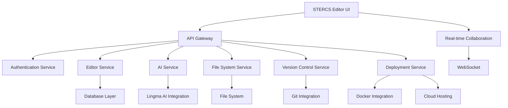

# STERCS No Code Drag and Drop Editor Documentation
## Version 1.0 - December 25, 2025

### Table of Contents
1. Introduction
2. System Architecture
3. Core Features
4. AI Integration
5. Development Environment
6. Database Design
7. API Documentation
8. Implementation Details
9. Security Considerations
10. Future Enhancements

## 1. Introduction

The STERCS No Code Drag and Drop Editor is a comprehensive visual development environment designed to enable members to create dynamic websites and applications without manual coding. This documentation provides a detailed overview of the implementation of the STERCS editor as a full-featured "mini Visual Studio Code" environment with AI capabilities and advanced development tools.

## 2. System Architecture

### 2.1 Technology Stack

- **Frontend**: TypeScript, React, Tailwind CSS, Vite
- **Backend**: Node.js, Express.js
- **Database**: PostgreSQL
- **Containerization**: Docker
- **AI Integration**: Lingma AI
- **Real-time Collaboration**: WebSocket

### 2.2 Architecture Diagram



## 3. Core Features Implementation

### 3.1 Visual Editor

The visual editor will be implemented with the following features:

- Drag-and-drop interface
- WYSIWYG editor
- Pre-built templates and components
- Responsive design controls
- Visual CSS/styling editor

### 3.2 Development Environment

The editor will include an integrated development environment with:

- Terminal (PowerShell, CMD, Node)
- File explorer
- Search functionality
- Version control
- Preview and auto-debug
- Container management
- Workspace preferences

### 3.3 AI Integration

Lingma AI will be integrated with the following capabilities:

- AI text and image generation
- Visual sitemap and wireframe generation
- AI code assistance
- Intelligent code suggestions
- Predictive debugging
- Automated documentation

## 4. Platform Theme Logic

### 4.1 Theme Management

The theme system will support:

- Theme toggling (light, dark, blue)
- Visual CSS/styling editor
- Template management
- Dynamic theme application

### 4.2 Theme Schema

```typescript
interface Theme {
  id: string;
  name: 'light' | 'dark' | 'blue';
  properties: {
    primaryColor: string;
    secondaryColor: string;
    backgroundColor: string;
    textColor: string;
    accentColor: string;
    borderRadius: string;
    boxShadow: string;
  };
}

interface Template {
  id: string;
  name: string;
  description: string;
  category: string;
  content: JSON;
  isPublic: boolean;
  authorId: string;
  createdAt: Date;
  updatedAt: Date;
}
```

## 5. Page Management System

### 5.1 Page Management Features

- Create new pages
- Publish/unpublish pages
- Dynamic pages with templates
- Advanced design and development features

### 5.2 Page Schema

```typescript
interface Page {
  id: string;
  projectId: string;
  title: string;
  slug: string;
  content: JSON;
  meta: {
    description: string;
    keywords: string[];
    author: string;
    ogImage: string;
    isPublished: boolean;
  };
  settings: {
    layout: 'stack' | 'flex' | 'grid';
    stackType: 'typescript' | 'javascript' | 'html';
    templateId: string;
    responsive: boolean;
    animations: boolean;
  };
  createdAt: Date;
  updatedAt: Date;
}
```

## 6. Database Design

### 6.1 Enhanced Database Schema

The database will be extended with the following tables:

- ai_prompt_history
- ai_generated_content
- code_snippets
- custom_styles
- workspace_settings
- containers
- terminal_sessions
- explorer_history
- version_control
- preview_settings
- member_preferences

### 6.2 Extended Schema SQL
```sql
-- AI Integration Tables
CREATE TABLE IF NOT EXISTS ai_prompt_history (
    id SERIAL PRIMARY KEY,
    member_id INTEGER REFERENCES stercs_members(id) ON DELETE CASCADE,
    prompt TEXT NOT NULL,
    response TEXT NOT NULL,
    type VARCHAR(50), -- text, image, code, etc.
    created_at TIMESTAMP DEFAULT CURRENT_TIMESTAMP
);

CREATE TABLE IF NOT EXISTS ai_generated_content (
    id SERIAL PRIMARY KEY,
    prompt_id INTEGER REFERENCES ai_prompt_history(id) ON DELETE CASCADE,
    content_type VARCHAR(50), -- text, image, code, etc.
    content TEXT,
    metadata JSONB,
    created_at TIMESTAMP DEFAULT CURRENT_TIMESTAMP
);

-- Code Snippets Table
CREATE TABLE IF NOT EXISTS code_snippets (
    id SERIAL PRIMARY KEY,
    member_id INTEGER REFERENCES stercs_members(id) ON DELETE SET NULL,
    name VARCHAR(100) NOT NULL,
    description TEXT,
    language VARCHAR(50), -- typescript, javascript, css, etc.
    code TEXT NOT NULL,
    tags TEXT[],
    is_public BOOLEAN DEFAULT FALSE,
    created_at TIMESTAMP DEFAULT CURRENT_TIMESTAMP,
    updated_at TIMESTAMP DEFAULT CURRENT_TIMESTAMP
);

-- Custom Styles Table
CREATE TABLE IF NOT EXISTS custom_styles (
    id SERIAL PRIMARY KEY,
    member_id INTEGER REFERENCES stercs_members(id) ON DELETE SET NULL,
    name VARCHAR(100) NOT NULL,
    css TEXT NOT NULL,
    is_global BOOLEAN DEFAULT FALSE,
    is_public BOOLEAN DEFAULT FALSE,
    created_at TIMESTAMP DEFAULT CURRENT_TIMESTAMP,
    updated_at TIMESTAMP DEFAULT CURRENT_TIMESTAMP
);

-- Workspace Settings
CREATE TABLE IF NOT EXISTS workspace_settings (
    id SERIAL PRIMARY KEY,
    member_id INTEGER REFERENCES stercs_members(id) ON DELETE CASCADE,
    settings JSONB NOT NULL,
    created_at TIMESTAMP DEFAULT CURRENT_TIMESTAMP,
    updated_at TIMESTAMP DEFAULT CURRENT_TIMESTAMP
);

-- Container Management
CREATE TABLE IF NOT EXISTS containers (
    id SERIAL PRIMARY KEY,
    member_id INTEGER REFERENCES stercs_members(id) ON DELETE CASCADE,
    name VARCHAR(100) NOT NULL,
    image VARCHAR(255) NOT NULL,
    ports JSONB,
    volumes JSONB,
    environment JSONB,
    status VARCHAR(50) DEFAULT 'stopped',
    created_at TIMESTAMP DEFAULT CURRENT_TIMESTAMP,
    updated_at TIMESTAMP DEFAULT CURRENT_TIMESTAMP
);

-- Terminal Sessions
CREATE TABLE IF NOT EXISTS terminal_sessions (
    id SERIAL PRIMARY KEY,
    member_id INTEGER REFERENCES stercs_members(id) ON DELETE CASCADE,
    session_id VARCHAR(255) NOT NULL,
    command_history TEXT[],
    created_at TIMESTAMP DEFAULT CURRENT_TIMESTAMP,
    last_used TIMESTAMP DEFAULT CURRENT_TIMESTAMP
);

-- Explorer History
CREATE TABLE IF NOT EXISTS explorer_history (
    id SERIAL PRIMARY KEY,
    member_id INTEGER REFERENCES stercs_members(id) ON DELETE CASCADE,
    path VARCHAR(512) NOT NULL,
    timestamp TIMESTAMP DEFAULT CURRENT_TIMESTAMP
);

-- Version Control
CREATE TABLE IF NOT EXISTS version_control (
    id SERIAL PRIMARY KEY,
    member_id INTEGER REFERENCES stercs_members(id) ON DELETE CASCADE,
    project_id INTEGER REFERENCES stercs_projects(id) ON DELETE CASCADE,
    commit_hash VARCHAR(64) NOT NULL,
    message TEXT,
    author VARCHAR(255),
    timestamp TIMESTAMP DEFAULT CURRENT_TIMESTAMP,
    diff TEXT
);

-- Preview Settings
CREATE TABLE IF NOT EXISTS preview_settings (
    id SERIAL PRIMARY KEY,
    member_id INTEGER REFERENCES stercs_members(id) ON DELETE CASCADE,
    settings JSONB NOT NULL,
    created_at TIMESTAMP DEFAULT CURRENT_TIMESTAMP,
    updated_at TIMESTAMP DEFAULT CURRENT_TIMESTAMP
);
```

## 7. API Documentation

### 7.1 AI Service Endpoints

- `POST /api/editor/ai/generate-text` - Generate text content using Lingma AI
- `POST /api/editor/ai/generate-image` - Generate images using Lingma AI
- `POST /api/editor/ai/generate-code` - Generate code using Lingma AI
- `GET /api/editor/ai/prompt-history` - Get AI prompt history

### 7.2 Development Environment Endpoints

- `POST /api/editor/terminal` - Execute terminal commands
- `GET /api/editor/explorer` - File explorer
- `POST /api/editor/explorer` - Create files/folders
- `PUT /api/editor/explorer` - Update files
- `DELETE /api/editor/explorer` - Delete files
- `GET /api/editor/search` - Search files
- `GET /api/editor/version-control` - Get version control history
- `POST /api/editor/version-control` - Commit changes
- `GET /api/editor/preview` - Get preview settings
- `POST /api/editor/preview` - Update preview settings
- `GET /api/editor/containers` - Get container status
- `POST /api/editor/containers` - Manage containers
- `GET /api/editor/preferences` - Get workspace preferences
- `POST /api/editor/preferences` - Update workspace preferences

## 8. Implementation Details

### 8.1 Implementation Roadmap

1. Lingma AI Integration
2. Terminal and Shell Integration
3. File Explorer and Search
4. Version Control System
5. Preview and Debugging System
6. Container Management
7. Workspace Preferences
8. Theme System Implementation
9. Page Management
10. Core Design & Layout Features
11. Full-Stack Development Tools
12. AI & Workflow Tools
13. Business & Management Solutions
14. Monetization/FIC Upgrades

## 9. Security Considerations

- All endpoints require authentication
- Role-based access control
- Input validation and sanitization
- Secure file handling
- AI content filtering
- Terminal command restrictions
- Container security
- Git security

## 10. Future Enhancements

- Visual debugging
- Real-time collaboration
- AI-powered design suggestions
- Enhanced container orchestration
- Advanced deployment options

This comprehensive documentation provides a foundation for implementing the STERCS No Code Drag and Drop Editor as a full-featured development environment with AI capabilities. The implementation will follow this architecture to create a powerful, extensible platform.